<!-- ORIX Clean / File: README.md / Author: Simon-Pierre Boucher / Contact: contact@spboucher.ai -->
<div align="center">


# ORIX Clean

### Reclaim Space. Keep Control.

**A native macOS storage analyzer and cleanup utility that measures everything it shows,<br>explains everything it proposes, and removes nothing without your confirmation.**

**Author: Simon-Pierre Boucher** · part of the **ORIX** family of Apple utilities


-6366F1?style=flat-square)


-06B6D4?style=flat-square)

<br>

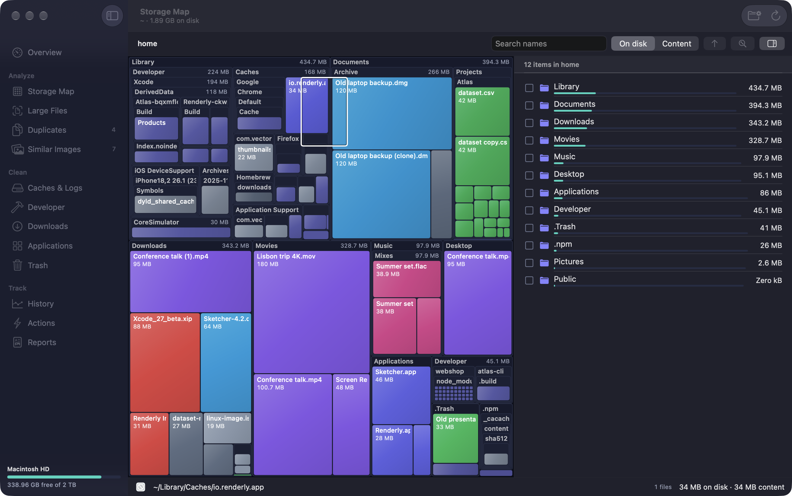

<sub>The storage map on the sample home folder. Every block is a real file or folder, sized by its measured size on disk.</sub>

</div>

> **About the screenshots.** They are captures of the real application (window captured by its window ID) running on a **generated sample home folder** of 182 real files (1.89 GB) written by `orix-bench fixture`, so that no personal file name appears here. Sizes, duplicate groups, similar-image groups and cleanup results are what the engines measured on those files. The History screenshot shows real free-space samples of the development Mac.

---

## Contents

1. [Overview](#1-overview) · 2. [Product Philosophy](#2-product-philosophy) · 3. [Application Preview](#3-application-preview) · 4. [Storage Analysis](#4-storage-analysis) · 5. [Interactive Storage Map](#5-interactive-storage-map) · 6. [Large Files](#6-large-files) · 7. [Duplicate Detection](#7-duplicate-detection) · 8. [Similar Images](#8-similar-images) · 9. [Cache Cleanup](#9-cache-cleanup) · 10. [Uninstall Assistant](#10-uninstall-assistant) · 11. [Leftover Files](#11-leftover-files) · 12. [Developer Cleanup](#12-developer-cleanup) · 13. [Downloads Cleanup](#13-downloads-cleanup) · 14. [Trash Analysis](#14-trash-analysis) · 15. [Cleanup Preview](#15-cleanup-preview) · 16. [Safe Deletion](#16-safe-deletion) · 17. [Storage Intelligence](#17-storage-intelligence) · 18. [Storage History](#18-storage-history) · 19. [ORIX Clean Actions](#19-orix-clean-actions) · 20. [Reports](#20-reports) · 21. [Filesystem Architecture](#21-filesystem-architecture) · 22. [APFS Considerations](#22-apfs-considerations) · 23. [Technology Stack](#23-technology-stack) · 24. [Installation](#24-installation) · 25. [Build Instructions](#25-build-instructions) · 26. [Testing](#26-testing) · 27. [Benchmarks](#27-benchmarks) · 28. [Privacy](#28-privacy) · 29. [Accessibility](#29-accessibility) · 30. [Localization](#30-localization) · 31. [Roadmap](#31-roadmap) · 32. [Release Status](#32-release-status) · 33. [Known Limitations](#33-known-limitations) · 34. [ORIX Ecosystem](#34-orix-ecosystem) · 35. [License](#35-license)

---

## 1. Overview

ORIX Clean answers three questions about a Mac's storage, in this order:

1. **Where did the space go?** A parallel scanner reads names and sizes straight from the filesystem and draws them as an interactive treemap.
2. **What could be removed, and what happens if it is?** Duplicates, similar pictures, caches, developer data, old downloads, applications and their files — each candidate comes with a reason, a risk level and a consequence.
3. **Do you really want that?** Every removal passes through a preview that lists the exact items. They go to the Trash, per-item outcomes are recorded, and they can be put back.

| | |
|---|---|
| **Platform** | macOS 15.0 or later, universal binary (built and run on macOS 27.0, Apple M5 Max) |
| **Language / UI** | Swift 6 (strict concurrency), SwiftUI + AppKit, Swift Charts, Canvas |
| **Core** | `ORIXCleanCore`, a UI-free Swift package: 19 files, 3,573 lines, 56 tests |
| **App** | 18 Swift files, 3,352 lines; 684 localized strings (English, Canadian French) |
| **Dependencies** | None. No third-party package, no network code, no helper tool |
| **Bundle identifier** | `ai.spboucher.orix.clean` |
| **Distribution** | Developer ID signed, Hardened Runtime, Apple notarization, DMG + ZIP |

## 2. Product Philosophy

| Principle | What it means in the code |
|---|---|
| **Every number is measured** | Sizes come from `getattrlistbulk(2)` during the scan. Nothing is derived from file names, and there is no simulated progress: counters shown during a scan are the scanner's own counters. |
| **Honest savings** | Recoverable space is a **range** when APFS reports shared blocks: from the sum of private sizes to the sum of allocated sizes. Hard links are reported as freeing nothing. |
| **No automatic cleanup** | Nothing is preselected in duplicates or similar images. A `CleanupAuthorization` can only be built from the plan the user confirmed; the engine skips anything else. |
| **Reasons, not fear** | Each candidate states why it is listed, what happens if it is removed and what it costs to get back. There are no urgency banners and no "your Mac is at risk" language. |
| **Nothing leaves the Mac** | No account, no analytics, no update check. `Scripts/check.sh` fails the build if networking APIs appear in the product sources. |
| **Supported APIs only** | No private API, no privileged helper, no administrator prompt, no attempt to get around System Integrity Protection or privacy controls. What cannot be read is reported as not read. |

## 3. Application Preview

<table>
<tr>
<td width="50%">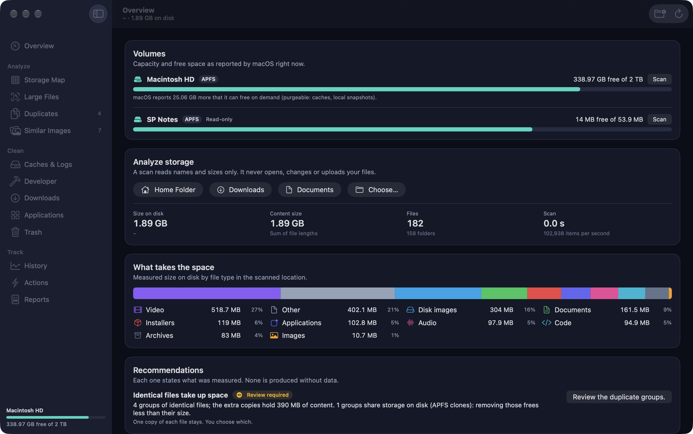<br><sub><b>Overview.</b> Volumes as macOS reports them, the measured breakdown by type, and recommendations that quote their evidence.</sub></td>
<td width="50%">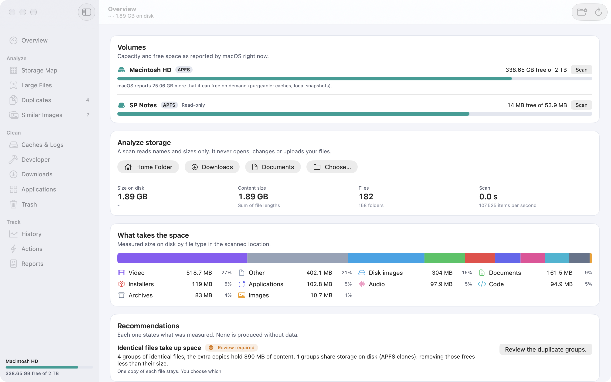<br><sub><b>Light mode.</b> The same screen with the light palette; appearance follows the system or the setting.</sub></td>
</tr>
<tr>
<td><br><sub><b>Storage map, dark.</b> Folders are frames, files are blocks coloured by type.</sub></td>
<td>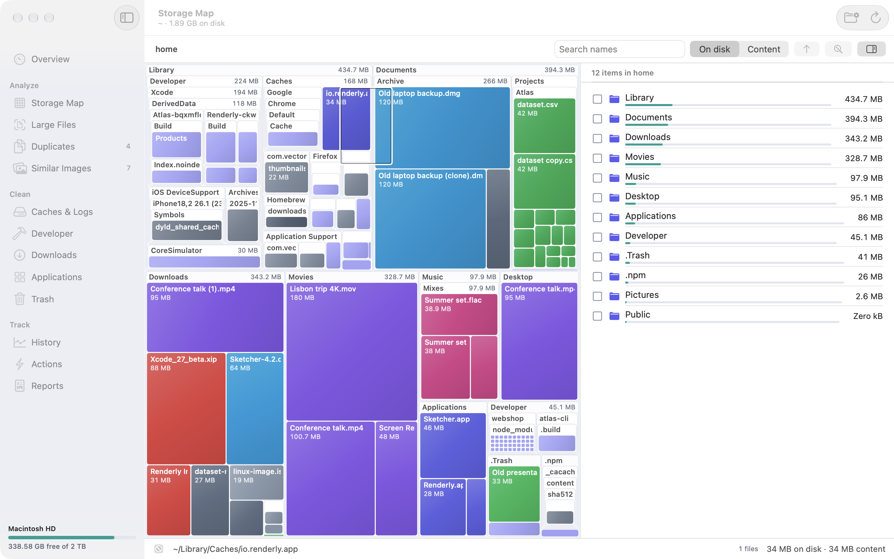<br><sub><b>Storage map, light.</b></sub></td>
</tr>
</table>

## 4. Storage Analysis

The scanner walks a folder or a volume with a small pool of threads. Each directory is read in one or a few system calls that return, for every entry, its name, type, device, modification date, link count, **content size**, **allocated size** and — on APFS — **private size**, clone identifier and sharing flags.

- **Three sizes, never mixed.** *Content size* is the length of the files. *Size on disk* is what is allocated. *Private size* is what APFS says would come back if that file alone were removed.
- **Accuracy check.** On a 31,259-object tree the allocated total equals `du -sk` to the byte (`2,412,920,832`); a test repeats this comparison on every run.
- **Never follows symbolic links.** Mount points and other devices are boundaries; a volume mounted inside the scanned folder is detected from the opened directory itself.
- **Hard links are counted once.** Other names of the same file are kept in the tree but add nothing to totals.
- **Cloud-only files are never opened.** Items whose content is not on the Mac (`SF_DATALESS`) are flagged; hashing or previewing them would download them.
- **Cancellable and pausable**, with live counters. Unreadable folders are listed as issues, and the totals say what is missing.
- **Startup volume.** Scanning `/` enters the Data volume through its firmlinks and skips `/System/Volumes`, so nothing is counted twice.

## 5. Interactive Storage Map

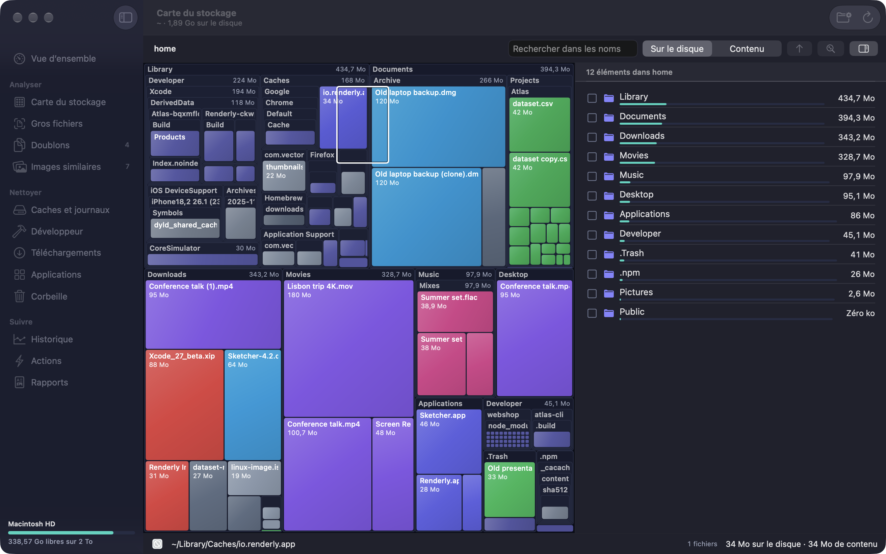
<sub>The map with the interface in Canadian French. Number and unit formats follow the locale.</sub>

- **Squarified treemap** drawn in a SwiftUI `Canvas`: area is proportional to measured size within each folder.
- **Level of detail.** Only regions large enough to see are laid out; siblings that would be under a few square points are merged into one cell labelled "*N* smaller items" with their real combined size. Laying out a 467,907-node tree takes 0.16 ms.
- **Interactions.** Double-click to drill down, breadcrumb to go back up, pinch to zoom (up to 12×), drag to pan, hover for details, right-click for *Reveal in Finder*, *Quick Look*, *Copy Path* and *Add to Cleanup Selection*.
- **Search** dims everything that does not match and lists the matches.
- **Two size modes** (on disk / content) and **two palettes** (ORIX, and the Okabe–Ito colour-blind-safe set).
- **A list beside the map** shows the same data sorted by size; it is the keyboard and VoiceOver path through the tree.

## 6. Large Files

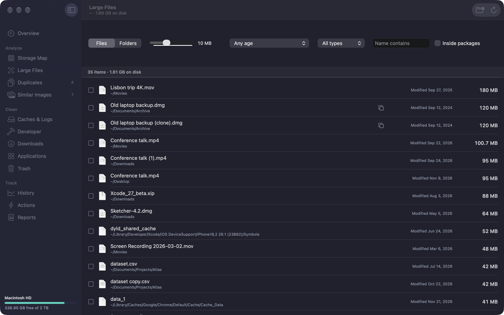

Largest files or largest folders, filtered by minimum size, age, type, name and whether to look inside packages. The age filter uses the modification date and says so: *not modified* is not *not used*. When Spotlight has recorded a last-opened date for a file, it is shown next to it as additional evidence; ORIX Clean never claims a file is unused.

## 7. Duplicate Detection

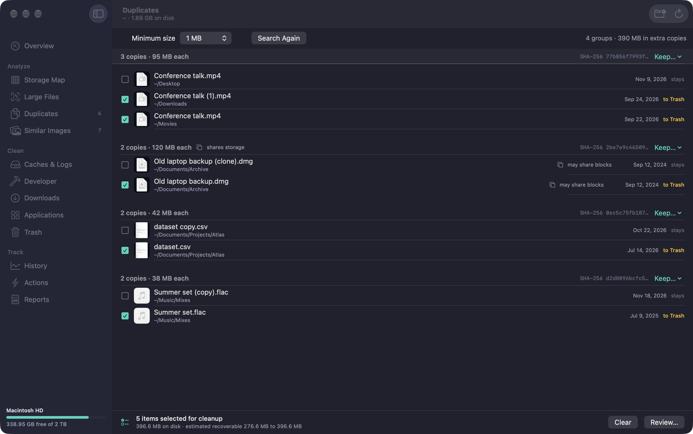
<sub>Four groups found in the sample. In the second, both files are APFS clones: the app says they share storage, and the selection bar gives the recoverable space as a range.</sub>

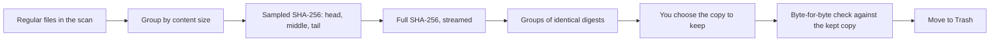

- The sampled hash only narrows candidates; **the full hash decides**. A test forces every sampled hash to collide and checks that no false group appears.
- A file whose size no longer matches the scan is dropped rather than compared.
- **Hard links** are one file under several names: not offered, because removing a name frees nothing.
- **APFS clones** are real duplicates that share blocks: flagged, with a recoverable range instead of a single figure.
- Files inside applications, photo libraries and other packages are skipped unless asked for.
- **One copy always stays.** The UI refuses to tick the last copy, and the deletion engine independently refuses to remove a duplicate whose kept copy is missing, selected, different, or the same inode.

## 8. Similar Images

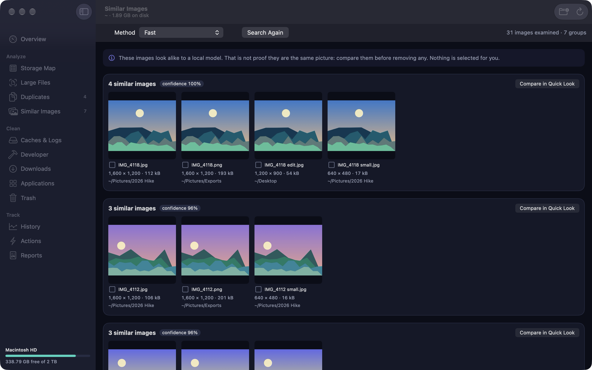

Two measurements are combined, both computed on the Mac: a 64-bit **difference hash** (structure) and a **Vision feature print** (appearance). Images whose structure is nearly identical (4 bits or fewer of 64) are grouped on structure alone; beyond that, Vision must agree. A *fast* mode compares structure first; a *thorough* mode compares every pair and also finds crops (limited to 3,000 images). Groups are built around a representative image, so a chain of "A resembles B, B resembles C" does not put A and C together. The confidence shown is the weakest link of the group. **Nothing is preselected**, and at least one image per group must stay.

## 9. Cache Cleanup

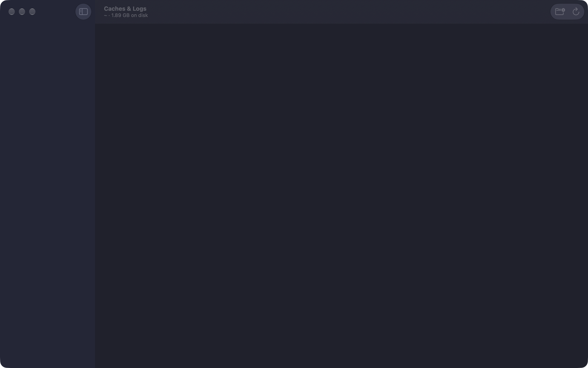

A documented catalogue of 35 locations (12 for caches and logs, 23 for developer tools): application caches in `~/Library/Caches`, web caches of eight browsers (the cache folder only — never the profile, history, cookies or passwords), logs, crash reports and old temporary items.

- **Not listed, on purpose:** Apple system caches (`com.apple.*`) and caches known to hold state (CloudKit, HomeKit, and others in an explicit exclusion list).
- Every row gives *why it is listed*, *what happens if you remove it*, *how you get it back*, and the estimated recoverable space.
- If the owning application is running, the row says so and the engine leaves the item in place.
- **No performance promise.** The screen states that removing caches does not make a Mac faster and that applications will use part of the space again.

## 10. Uninstall Assistant

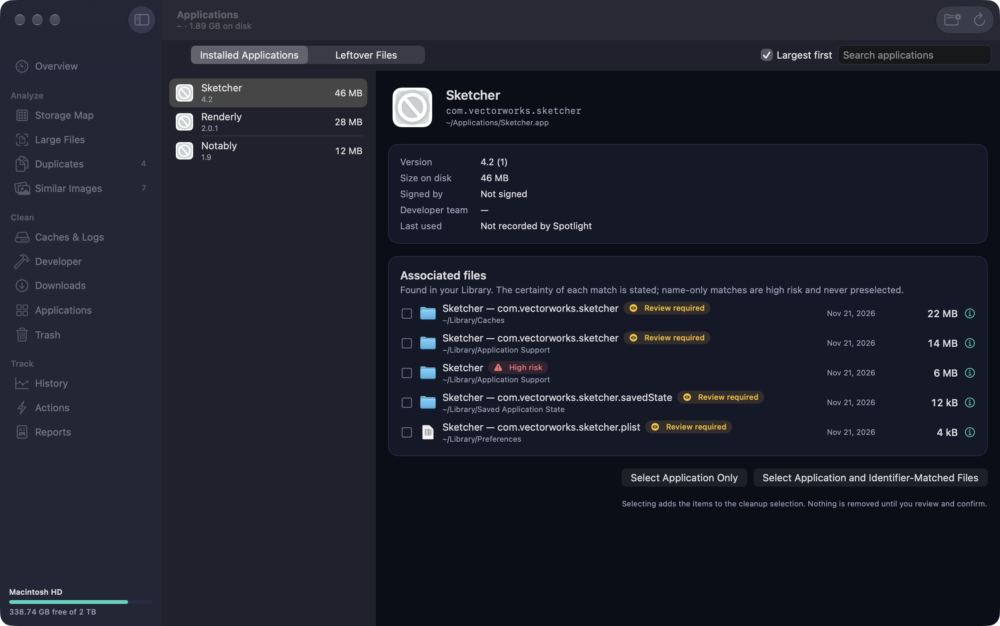

For each installed application: size, version, bundle identifier, who signed it (read from the static code signature, without running it), team identifier and the last-used date Spotlight recorded. Associated files are searched in twelve Library locations and labelled by certainty:

| Certainty | Rule | Risk |
|---|---|---|
| Matches the bundle identifier | Named exactly after the identifier (or a helper identifier that extends it) | Review required |
| Shared by the developer's apps | Group container keyed by the team identifier | High — never preselected |
| Name match only | Named after the application's display name | High — never preselected |

Documents are never part of an uninstall. Applications that ship with macOS are shown but cannot be selected.

## 11. Leftover Files

Library items named after an application identifier for which no installed application is found (by the scan of the application folders and by Launch Services). The screen says plainly that this is an **inference from names**: command-line tools, plug-ins and applications on other volumes can look like leftovers. Items sharing a vendor prefix with an installed application are not flagged. Everything is *review required*.

## 12. Developer Cleanup

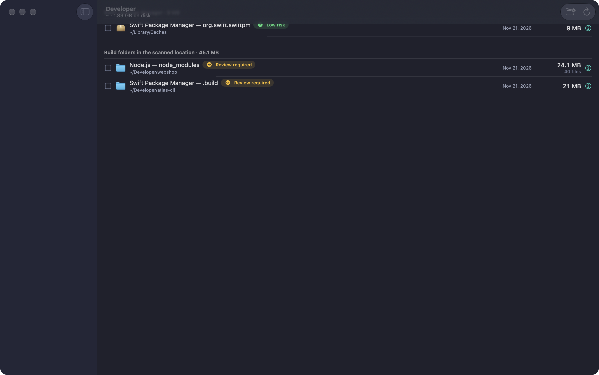

Xcode DerivedData (one row per project), archives (marked *review*: they hold the dSYMs of shipped builds), device support files, simulator caches, and the caches of Swift Package Manager, CocoaPods, Carthage, Homebrew, npm, Yarn, pnpm, pip, uv, Gradle, Maven, Cargo, Go and Playwright. After a scan, build folders (`node_modules`, `.build`, `target`…) are listed only when they sit next to their project manifest.

**Reported but never removed:** simulator devices, simulator runtimes and the Docker disk image, each with the supported command or menu to clean it.

## 13. Downloads Cleanup

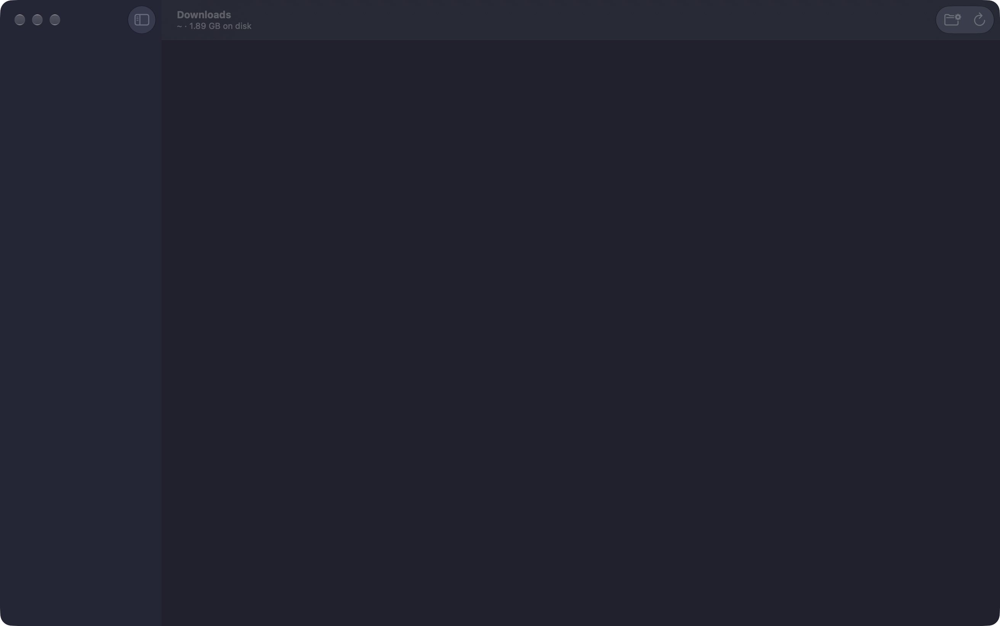

Installers, disk images, archives and incomplete browser downloads, with the date each arrived in the folder. An archive that sits next to an item of the same name is noted as "may be already extracted (not verified)". Everything here is *review required*.

## 14. Trash Analysis

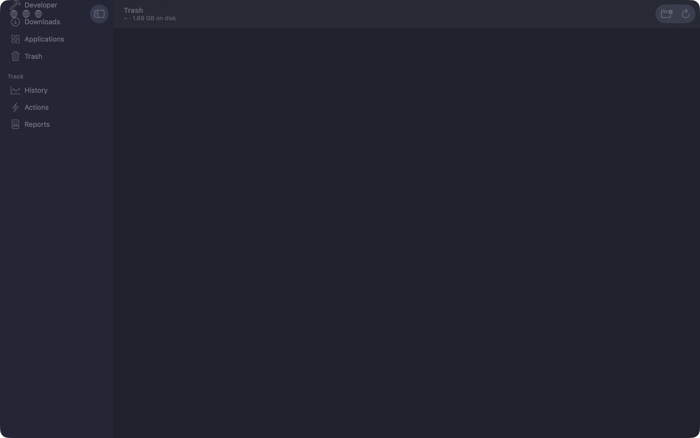

Size and content of the Trash of the home folder and of each mounted volume. Reading the Trash requires Full Disk Access; without it the screen says the content is unknown instead of showing zero. Emptying is the only permanent deletion in the application: it has its own confirmation that requires typing `DELETE`.

## 15. Cleanup Preview

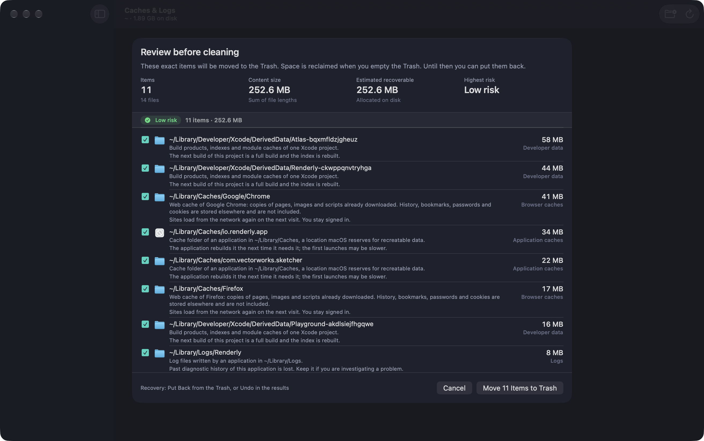

No removal can start anywhere else. The preview shows every path, grouped by risk, with its reason and consequence, the content size, the estimated recoverable space and the recovery option. Items can be unticked there. High-risk items require a separate acknowledgement.

## 16. Safe Deletion

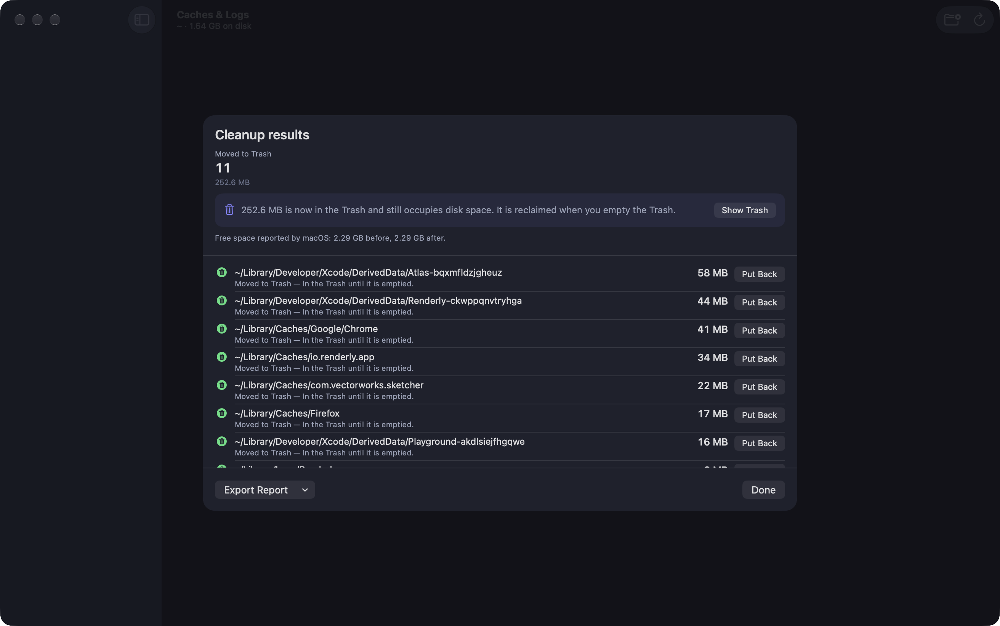
<sub>Result of a real cleanup of the sample caches. The app states that the space is still occupied until the Trash is emptied.</sub>

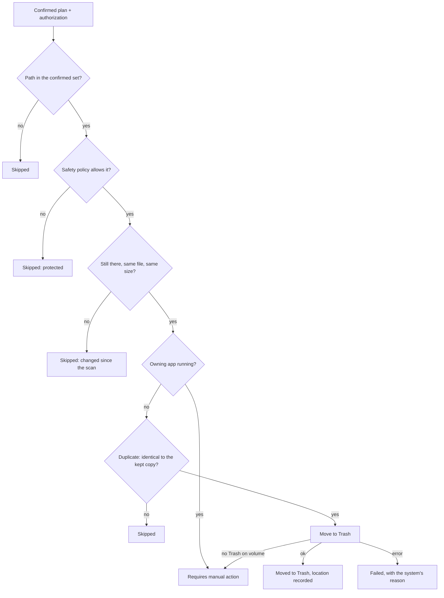

- **Five outcomes**, never merged: *Moved to Trash*, *Permanently deleted*, *Skipped*, *Failed*, *Requires manual action*.
- **A last line of defence** (`SafetyPolicy`) refuses system areas, standard folders themselves, volume roots, the inside of application bundles and of photo, music and video library packages — whatever asked.
- **Put Back** restores an item while it is still in the Trash, and refuses to overwrite anything that now occupies the original place.
- A volume without a Trash yields *Requires manual action*; the engine never falls back to permanent deletion.

## 17. Storage Intelligence

Recommendations are computed only from data that has actually been analysed; an analysis that has not run produces none. Each one carries its evidence (counts, measured sizes, paths), a risk level, the consequence and a link to the relevant screen. Thresholds are constants in `RecommendationEngine`. A growth projection is offered only with at least three samples over six hours, and is labelled a projection.

## 18. Storage History

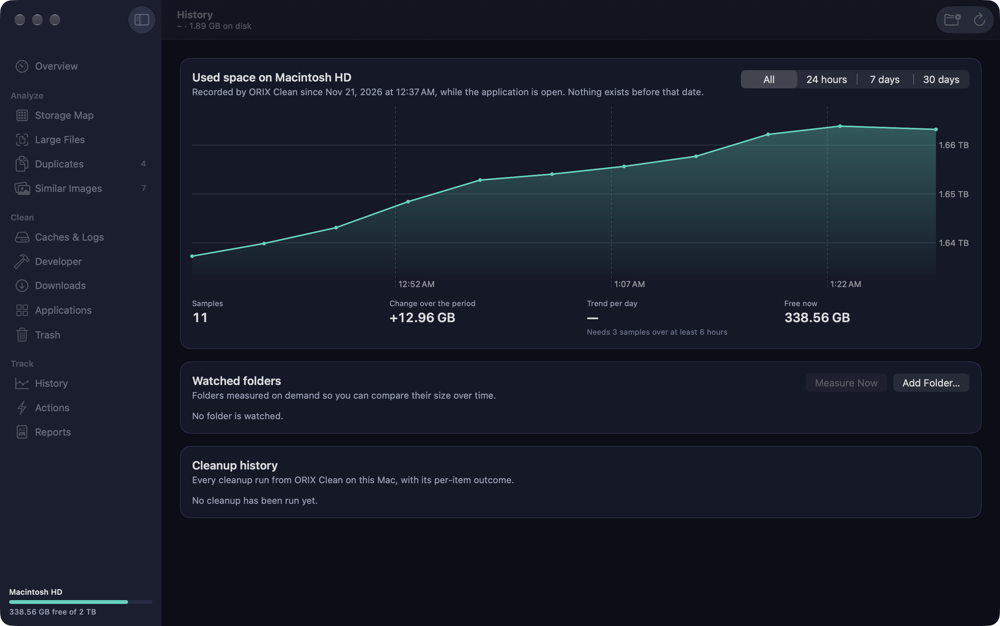

Free-space samples of each volume (every 15 minutes while the application is open, and after each scan and cleanup), sizes of watched folders, and the log of every cleanup with its per-item outcome. The chart starts at the first recorded sample and the screen says that nothing exists before it.

## 19. ORIX Clean Actions

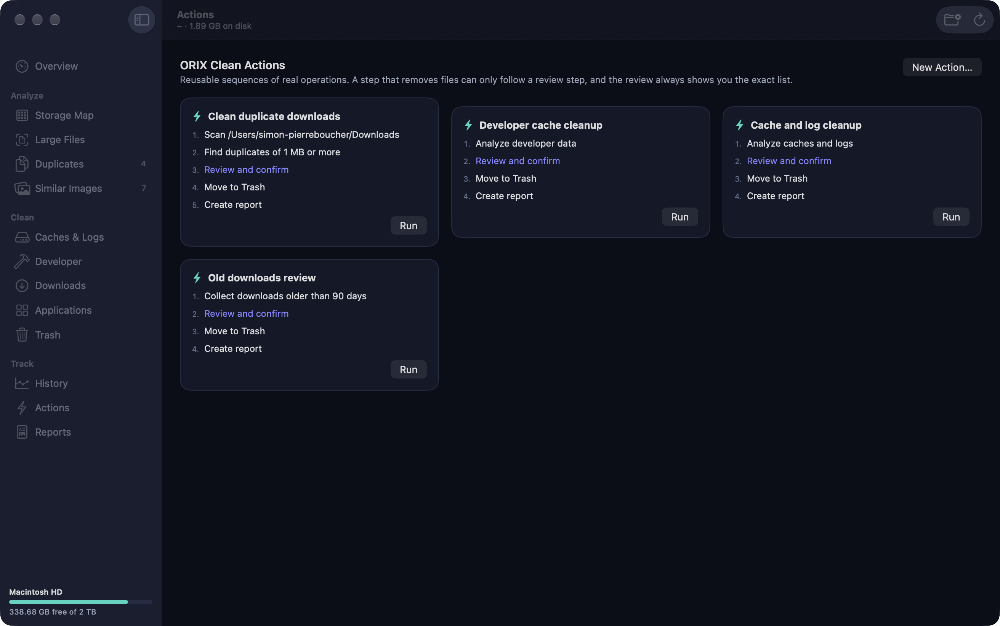

Reusable sequences of real operations: scan, find duplicates, collect caches, developer data or old downloads, **review**, move to Trash, report. A workflow is rejected at save time and at run time unless every removal step comes directly after a review step, and that review is the same preview sheet. Declining it ends the run with nothing removed.

## 20. Reports

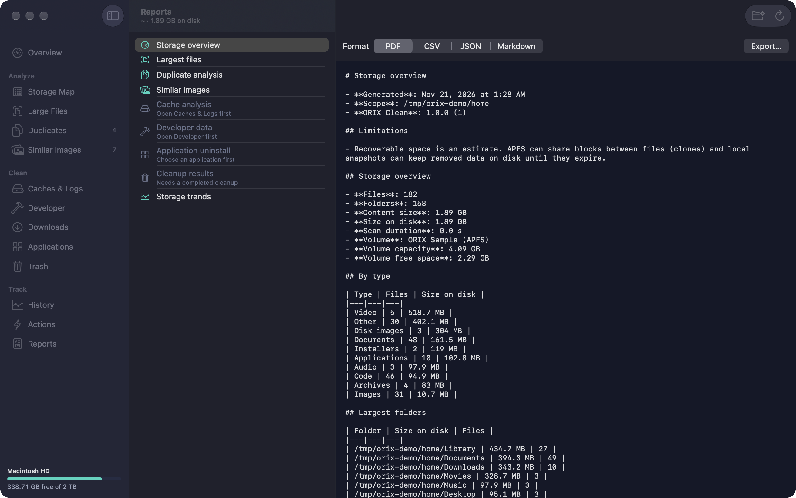

Nine report types (storage overview, largest files, duplicates, similar images, caches, developer data, application uninstall, cleanup results, storage trends) exported as **PDF, CSV, JSON or Markdown**. Each includes the scan date and scope, what could not be read, measured sizes, estimated recoverable space and actual results. CSV cells that start with a formula character are neutralised.

## 21. Filesystem Architecture

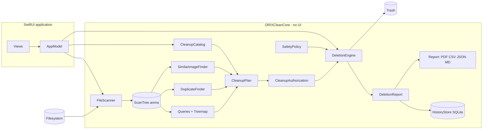

The scan result is an arena of fixed 64-byte records (parent, children range, flags, three sizes, date, file id) plus one name buffer — about 125–160 bytes per object in practice. Children always follow their parent, so directory totals are one reverse pass. Details: [`docs/architecture/`](docs/architecture/overview.md).

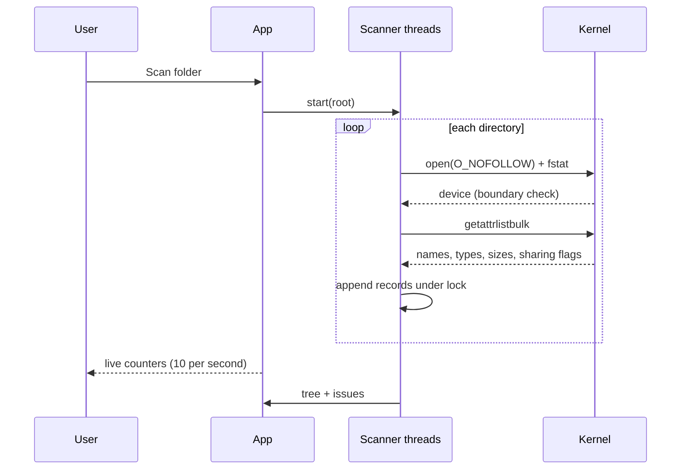

## 22. APFS Considerations

| Situation | What ORIX Clean does |
|---|---|
| **Clones** (`cp -c`, Finder duplicates) | Both files show their full allocated size; the private size shows what removal would really free. Recoverable space is given as a range. |
| **Hard links** | Counted once in totals; never offered as duplicates. |
| **Sparse files** | Content size and size on disk are both shown; the map can use either. |
| **Transparent compression** | Allocated size reflects the compressed size; flagged in the tree. |
| **Local snapshots** (Time Machine, updates) | Not enumerated. Data removed today can stay on disk until the snapshot expires — stated in every report. |
| **Purgeable space** | The figure macOS reports is shown separately on the Overview; ORIX Clean does not claim it. |
| **Cloud-only files** | Counted as zero on disk, never read. |
| **Trash** | Moving to the Trash frees nothing until the Trash is emptied — stated in the preview and in the results. |

## 23. Technology Stack

| Area | Technology |
|---|---|
| Language | Swift 6, strict concurrency, `MainActor` default isolation in the app |
| UI | SwiftUI, AppKit (panels, Quick Look, workspace), Swift Charts, `Canvas` |
| Filesystem | `getattrlistbulk`, `getattrlist`, `clonefile` (tests), `FileManager.trashItem` |
| Hashing | CryptoKit SHA-256, `F_NOCACHE` streaming reads |
| Images | ImageIO thumbnails, Vision feature prints, Accelerate |
| Signatures | Security framework (`SecStaticCode`) |
| Persistence | SQLite (C API), WAL |
| Reports | Core Text / Core Graphics PDF, Codable JSON |
| Project | XcodeGen, Swift Package Manager, Swift Testing, XCUITest |

Decisions and their reasons (Canvas rather than Metal, SQLite rather than SwiftData, no updater, no helper) are recorded in [`docs/architecture/overview.md`](docs/architecture/overview.md).

## 24. Installation

1. Download `ORIXClean-1.0.0.dmg` (see [Release Status](#32-release-status)).
2. Check it: `shasum -a 256 ORIXClean-1.0.0.dmg` must match `SHA256SUMS.txt`.
3. Open the disk image and drag **ORIX Clean** to **Applications**.
4. Optional: System Settings › Privacy & Security › Full Disk Access › enable ORIX Clean, to include protected folders and the Trash.

## 25. Build Instructions

```bash
brew install xcodegen create-dmg          # project generator, DMG builder
Scripts/build.sh generate                 # strings catalogue + Xcode project
Scripts/build.sh core-test                # 56 engine tests (swift test)
Scripts/build.sh debug                    # Debug build
Scripts/build.sh uitest                   # 8 UI scenarios on a disposable disk image
Scripts/sign.sh                           # Release, universal, Developer ID, Hardened Runtime
Scripts/notarize.sh                       # Apple notarization + stapling (existing keychain profile)
Scripts/package.sh && Scripts/notarize.sh dist/ORIXClean-1.0.0.dmg dmg && Scripts/finalize.sh
```

Requirements: Xcode 27 (Swift 6.2 or later for default actor isolation), macOS 15 SDK or later. More in [`docs/development/setup.md`](docs/development/setup.md).

## 26. Testing

| Suite | Tests | What it proves |
|---|---|---|
| Scanner | 16 | Totals equal the kernel's and `du`; Unicode and 1,500-byte paths; symlink loops; hard links; APFS clones; sparse files; permission denied; files changing during 25 scans; 32,000 files; packages; cancel and pause; mounted volume boundary and removal |
| Treemap | 1 | Areas proportional, inside the parent, no overlap, honest aggregate cell, viewport culling |
| Duplicates | 9 | Exact groups and digest equal to `shasum`; a one-byte difference outside the sampled windows; forced sample collisions; hard links; clones; 48 MB files; unreadable and changed files; packages; cancellation |
| Similar images | 3 | Resized, recompressed and PNG copies grouped; unrelated images not grouped; crops in thorough mode; corrupt images counted |
| Safety policy | 2 | 39 protected paths refused, 13 ordinary paths allowed |
| Deletion | 11 | No removal without authorization; high-risk acknowledgement; real Trash and Put Back; no overwrite on restore; vanished, replaced and changed items; duplicate verification; a group is never emptied; partial failure; running applications; read-only and full volumes |
| Catalogue, downloads, Trash | 6 | Only documented locations; exclusions; every rule documented; build folders need their manifest |
| Applications | 3 | Discovery, associated files by certainty, system apps never offered, conservative leftovers |
| History, reports | 3 | SQLite round trip, trend, recommendations only from evidence, four renderers, CSV formula neutralisation |
| Workflows | 2 | Removal without review is invalid; a declined review removes nothing |
| **UI (XCUITest)** | 8 | First launch; scan, map and search; large files; duplicates; similar images; caches, developer, downloads, Trash; uninstall preview → cancel → real cleanup → Put Back; report export; declined action; light mode, settings, window sizes |

Destructive tests run only on temporary directories and on disk images created for the test. Core line coverage: **86.7 %** (2,662 of 3,070 lines). Details: [`docs/development/testing.md`](docs/development/testing.md).

## 27. Benchmarks

Measured on 2026-11-21, MacBook Pro (Mac17,6, Apple M5 Max, 48 GB), macOS 27.0, internal APFS SSD, release build, warm file cache. Reproduce with `orix-bench`.

| Measurement | Result |
|---|---|
| Scan `~/Library/Developer` — 985,558 files, 699,525 folders | 17.4 s · 96,757 objects/s · 202 MB peak memory |
| Scan `/Applications` — 448,727 files, 64,278 folders, 3 threads | 3.04 s · 168,644 objects/s · 8.9 CPU-s · 77 MB |
| Same, 1 thread / 8 threads | 3.45 s, 3.4 CPU-s / 4.07 s, 23.4 CPU-s |
| Treemap layout, 467,907 nodes at 1600×1000 | 0.16 ms → 1,798 cells |
| Duplicate search, sample folder (685 MB hashed) | 0.07 s (warm cache; cold reads are bound by the disk) |
| Similar images, sample folder (31 images, fast mode) | 0.21 s |
| Signed application size | 13 MB (universal) |

Directory enumeration is bound by the filesystem rather than by cores, which is why the default is three threads (one in Low Power Mode or under thermal pressure). Method and raw numbers: [`docs/development/performance.md`](docs/development/performance.md).

## 28. Privacy

- No account, no network code, no analytics, no advertising, no update check.
- A scan reads names and metadata. File contents are read only for the analyses you start (hashing, image fingerprints), and stay in memory.
- Stored locally in `~/Library/Application Support/ORIX Clean/history.sqlite`: volume samples, watched-folder sizes, cleanup logs, saved actions. *Settings › Privacy & Access › Erase History* removes them.
- macOS asks before the app reads Desktop, Documents, Downloads, removable or network volumes. Full Disk Access is optional and never requested by a prompt of ours.

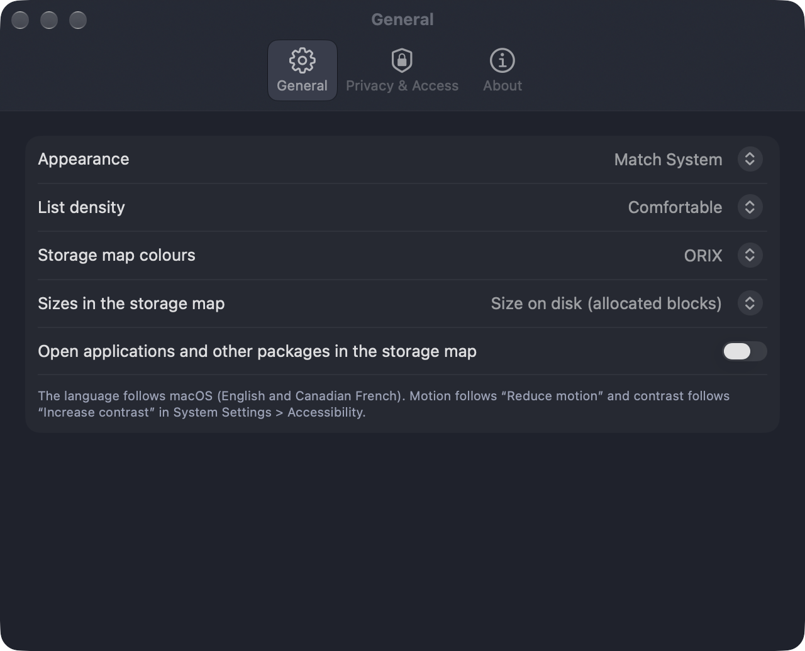

More: [`docs/PRIVACY.md`](docs/PRIVACY.md).

## 29. Accessibility

VoiceOver labels on controls and rows, full keyboard navigation (`⌘1`–`⌘9` sections, `⌘O` scan, `⌘↩` review), a list equivalent of the treemap, a colour-blind-safe map palette, risk levels that differ by shape as well as colour, respect for Reduce Motion, and a compact density for the Large Files list. **Not verified:** no session with a VoiceOver user and no instrumented contrast measurement — see [`docs/ACCESSIBILITY.md`](docs/ACCESSIBILITY.md).

## 30. Localization

English and Canadian French (684 strings). Sizes, numbers and dates are formatted for the locale. Known gap: strings have no plural variants yet, so "1 items" / « 1 éléments » can appear.

## 31. Roadmap

- Plural-aware strings.
- A Finder-sync or Services entry point ("Analyze with ORIX Clean").
- Background sampling (login item) so history does not depend on the app being open.
- Signed automatic updates, if a way is found that keeps the "no network code by default" promise.
- Sunburst as an alternative view of the map.
- An Icon Composer layered icon for macOS 26 and later.

## 32. Release Status

| Item | Status (2026-11-21) |
|---|---|
| Version | 1.0.0, build 1 |
| Source repository | Private, `gitsrv:srv/git-private/orix-clean.git` (SSH only). git.spboucher.ai serves public repositories only, so the repository is deliberately **not** on the forge. |
| Developer ID signature | Valid — `Developer ID Application: Simon-Pierre Boucher (3YM54G49SN)`, Hardened Runtime, secure timestamp, no entitlements |
| Apple notarization — app | **Accepted**, submission `c2e7cbaa-9410-466f-b912-b9666f5a02b7`, ticket stapled |
| Apple notarization — DMG | **Accepted**, submission `ff776146-c989-45d6-99de-c93bb217d8c1`, ticket stapled |
| Gatekeeper | `accepted`, source *Notarized Developer ID*, for the app, the DMG and the app extracted from the ZIP |
| `ORIXClean-1.0.0.dmg` | 5,133,225 bytes · SHA-256 `c7a8b13f3db143e80d2902882d8fe069d68b6e89a1de212411dffdb7334bcd34` |
| `ORIXClean-1.0.0.zip` | 4,032,161 bytes · SHA-256 `126a980dd974136fc958ff7ab9a9b735d68aa2cc162d2729fa4f7d55a03da9fd` |
| SPB Git release | **Not published.** A release on git.spboucher.ai is public; it waits for the owner's authorization. The artifacts are in `dist/` on the build Mac. |
| README rendering on SPB Git | Not verified (the repository is not on the forge). Image paths and Mermaid blocks were checked locally. |

Full detail: [`RELEASE-REPORT.md`](RELEASE-REPORT.md).

## 33. Known Limitations

- **Tested on one configuration only**: macOS 27.0 on Apple Silicon. Built for macOS 15.0+ and as a universal binary, but macOS 15, macOS 26 and the Intel slice have never been run.
- **Memory grows with the number of objects** (about 125–160 bytes each). A whole-disk scan of a Mac with 15 million files would need roughly 2 GB; not measured.
- **Scan results are not persisted**: quitting the app discards the tree.
- **Recoverable space is an estimate.** Clones, snapshots and purgeable accounting are outside the app's control; private sizes of a folder are a lower bound.
- **Leftover and name-based associations are inferences**, labelled as such.
- **The "unused" notion does not exist in the app**: only modification dates and Spotlight's last-used date, when recorded.
- **Root-owned items** (some App Store or system-wide installs, `/Library` caches) cannot be removed, because the app never elevates privileges; the attempt is reported as failed.
- **History is recorded only while the app runs.**
- **Similar images**: thresholds were calibrated on generated pictures; behaviour on large real photo collections has not been evaluated. Photo libraries are not opened.
- **Similar-image and treemap panning with a mouse wheel** are not implemented (pinch and drag only).
- **Increase Contrast is not handled** by the custom colours and the map; the density setting applies to the Large Files list only.
- **No automatic updates.**
- **Sandbox**: the app is not sandboxed (a disk analyzer needs broad read access), so it cannot be distributed on the Mac App Store as is.

## 34. ORIX Ecosystem

| App | Platform | Purpose |
|---|---|---|
| **ORIX Clean** | macOS | Storage intelligence and cleanup |
| ORIX Scan | iOS / iPadOS | Document scanner with on-device OCR |
| ORIX Calc | iOS / iPadOS | Universal calculator |
| ORIX Audio | iOS / iPadOS | Recorder with on-device transcription |

Shared principles: no account, everything on the device, every advertised feature works, every limitation is written down.

## 35. License

All rights reserved © 2026 Simon-Pierre Boucher. See [`LICENSE`](LICENSE).

---

<div align="center"><sub><b>ORIX Clean — Reclaim Space. Keep Control.</b><br>Author: Simon-Pierre Boucher · contact@spboucher.ai</sub></div>
