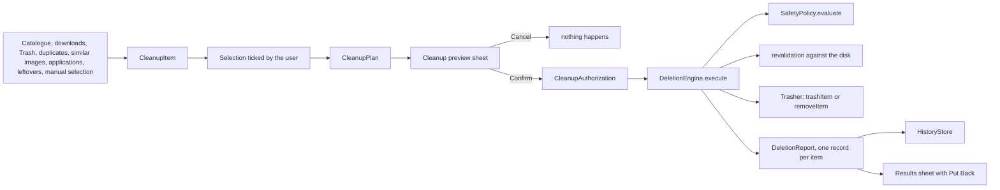
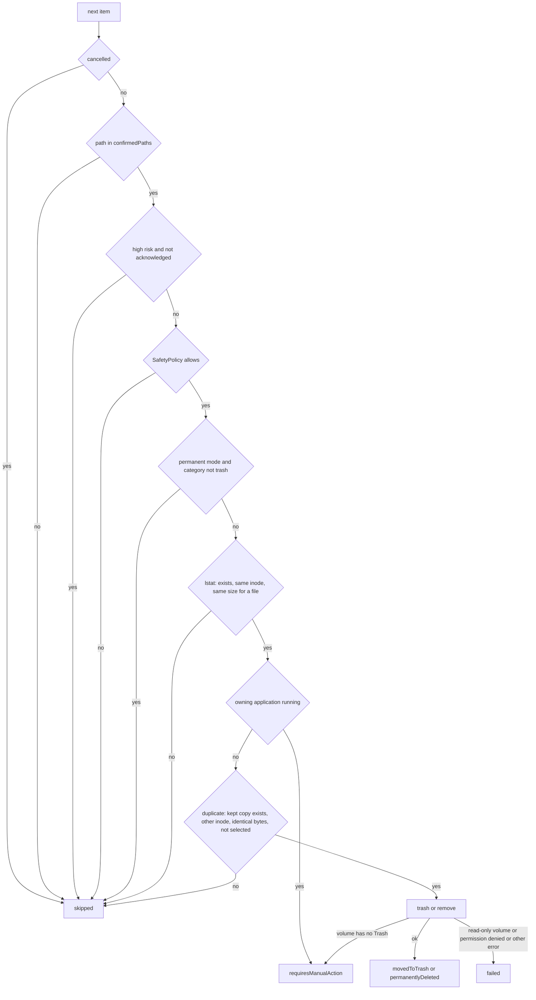

<!-- ORIX Clean / File: docs/architecture/cleanup.md / Author: Simon-Pierre Boucher / Contact: contact@spboucher.ai -->
# Cleanup

Everything between "this could be removed" and "this was moved to the Trash". Sources: `CleanupPlanner/`
(`CleanupModel`, `CleanupCatalog`, `DownloadsAndTrash`), `SafeDeletion/` (`SafetyPolicy`, `DeletionEngine`),
`Applications/AppInventory.swift`, `Actions/Workflow.swift`, and `AppModel` plus `CleanupPreviewSheet` in the
application.

## The chain

| Type | Role | Key fields |
|---|---|---|
| `CleanupItem` | One proposal | `path`, `category`, `risk`, `reason`, `consequence`, `measurement`, `owner`, `regeneration`, `closeFirst`, `verifyAgainst`, `confidenceNote` |
| `CleanupPlan` | The set shown in the preview | De-duplicated items sorted by allocated size; totals, `recoverable`, `highestRisk`, `byRisk`, `appsToClose` |
| `CleanupAuthorization` | Consent for a precise list | `confirmedPaths`, `highRiskAcknowledged`, `confirmedAt` |
| `DeletionEngine` | Executes | `execute(plan:authorization:mode:runningBundleIDs:)`, `restore(_:)`, `cancel()` |
| `DeletionReport` | Outcome | `records`, `mode`, `cancelled`, `freeBefore`, `freeAfter` |

`CleanupPlan.init` keeps a path once and drops any item that lies inside another listed directory, so nested
selections are not counted twice.

`Risk` has three levels: `low` (recreatable data in a documented location), `review` (may hold something the
user wants) and `high` (potentially important application or system data).

`CleanupAuthorization` can only be built from a plan. In the application it is created in one place,
`AppModel.confirm`, which is called by the confirm button of the preview. (A Debug-only screenshot helper,
`runDemo`, also creates one; it requires a substitute home folder and is not compiled into Release builds.)

## Where candidates come from

| Source | Items | Risk |
|---|---|---|
| `CleanupCatalog.discover(.caches)` | Each entry of `~/Library/Caches` and `~/Library/Logs`, crash reports, eight browser caches | low |
| same | Items in the user temporary folder not modified for 7 days | review |
| `CleanupCatalog.discover(.developer)` | 23 documented locations: DerivedData per project, device support, previews, SwiftPM, CocoaPods, Carthage, Homebrew, npm, Yarn, pip, Gradle, Cargo, Go build, Playwright, and others | low; review for Xcode archives, pnpm store, uv cache, Maven repository, Go module cache |
| `CleanupCatalog.buildArtifacts` | `node_modules`, `.build`, `target`, `.gradle` next to their manifest; `DerivedData`, `__pycache__`; 20 MB or more; not under a `Library` folder | review |
| `DownloadsAnalyzer` | Top-level items of Downloads, classified as installer, disk image, archive, incomplete download, other | review |
| `TrashAnalyzer` | Items of `~/.Trash` and of `.Trashes/<uid>` on other volumes | review |
| Duplicates, similar images | See `duplicates.md` | review |
| `AppInventory.uninstallItems` | Application bundle and chosen associated files | review; high when the association is not an exact identifier match |
| `LeftoverFinder` | Library items named after an identifier with no matching application | review, with a confidence note |
| Storage map and Large Files | Any node the user ticks | review |

Catalogue exclusions: names in `excludedCacheNames`, anything starting with `com.apple.`, `.DS_Store`, items
under 64 KiB, and paths claimed by a more specific rule. Every rule has a reason, a consequence and a
regeneration note (test `everyRuleIsDocumented`). Simulator devices, simulator runtimes and the Docker disk
image are `ManualHint` values: measured and explained, never candidates.

## SafetyPolicy deny rules

`SafetyPolicy.evaluate(path)` is the last check and applies whatever produced the item. Paths are normalized
first (`/tmp`, `/var`, `/etc` to `/private/...`; a `/System/Volumes/Data` prefix removed).

| Rule | Denied |
|---|---|
| Form | Relative paths; any path containing a `..` component; `/` |
| System areas | `/System`, `/usr`, `/bin`, `/sbin`, `/private/etc`, `/private/var/db`, `/private/var/root`, `/Library/Apple`, `/cores`, `/dev`, `/opt`, `/Library/Developer/CommandLineTools`, `~/Library/Keychains`, and everything below them |
| `/private/var` | Everything except items deep inside `/private/var/folders/` and items in `/private/var/tmp/` |
| System folders themselves | `/private`, `/private/tmp`, `/private/var/tmp` |
| Top-level folders themselves | `/Applications`, `/Applications/Utilities`, `/Library`, `/Users`, `/Users/Shared`, `/Volumes`, the home folder, `~/Library`, `~/Applications` |
| Structural children | Direct children of `/Library`, `~/Library` and `/Users`; in the home folder, the standard folders Desktop, Documents, Downloads, Movies, Music, Pictures, Public, Library, Applications and `.Trash` |
| Volumes | The root of any volume under `/Volumes`; its `.Trashes`, `.Spotlight-V100` and `.fseventsd` folders |
| Inside bundles | Any path with an `.app` component above the last one: remove the whole application or nothing |
| Inside libraries | Any path inside a `photoslibrary`, `musiclibrary`, `tvlibrary`, `aplibrary`, `imovielibrary`, `fcpbundle`, `logicx`, `sparsebundle`, `pvm`, `vmwarevm` or `utm` package |

The policy is a deny list on location. It does not make a judgement about value: a whole application, a
whole photo library, a non-standard folder or a dotfile folder in the home directory is allowed if the user
selects and confirms it.

## Execution and revalidation

For each item of the plan, in order, the engine stops at the first check that fails and writes one record.

Revalidation uses what was measured when the item was listed: the inode number (`measurement.fileID`, when
known) and, for a regular file, the logical size. An item that vanished, was replaced by another file or
changed size is skipped with the reason in the record. A directory is checked by inode only.

### Statuses

| Status | Meaning |
|---|---|
| `movedToTrash` | In the Trash of its volume; `trashPath` records where, when the system reported it |
| `permanentlyDeleted` | Removed with `FileManager.removeItem`; only possible for Trash items |
| `skipped` | Not attempted; `detail` says why (cancelled, not confirmed, protected, gone, replaced, changed, verification failed) |
| `failed` | Attempted and refused by the system (read-only volume, permission denied, other error text) |
| `requiresManualAction` | The user must do something first: quit an application, or remove the item in Finder because the volume has no Trash |

Every item ends with exactly one record. A partial failure never aborts the run.

## Trash versus permanent

- `moveToTrash` is the default and the only mode for everything that is not already in the Trash. It uses
  `FileManager.trashItem`, which places the item in the Trash of its own volume. It is a rename, so it works on
  a full volume and frees nothing by itself; the preview and the results say so.
- `permanent` is used only by "Empty Trash" and "Delete Permanently" in the Trash section. The engine refuses
  it for any item whose category is not `trash`. The preview then requires typing `DELETE`.
- If a volume has no Trash (`NSFeatureUnsupportedError`), the item is left in place with
  `requiresManualAction`; the engine never falls back to permanent deletion.

## Undo

`DeletionEngine.restore(record)` moves an item from its recorded Trash path back to its original path. It
returns `notInTrash` when the item is no longer there, `destinationOccupied` when something now exists at the
original path (nothing is overwritten), or `failed` with the system message. The application marks the record
`restored`, saves the updated report and refreshes the Trash. Restoration is offered in the results sheet and
from the cleanup log in History for as long as the item stays in the Trash. Permanently deleted items have no
undo.

## Workflows: removal only right after review

`Workflow.validate()` walks the steps with a `reviewed` flag: scan and collection steps clear it, `review` sets
it, `moveToTrash` requires it and clears it. A workflow with a removal that does not directly follow a review
(reports aside) throws `removalWithoutReview` and does not start. At run time `WorkflowRunner` passes the
collected plan to the `WorkflowReviewer`; a nil answer ends the run with "Nothing was removed", and only the
plan and authorization returned by the reviewer reach the engine. Built-in collection steps keep low-risk
catalogue items only; duplicate steps keep the first path of each group and verify the others against it.

## Invariants

- No authorization, no removal; an item outside `confirmedPaths` is skipped even if it is in the plan.
- High-risk items need `highRiskAcknowledged`, set by a separate checkbox in the preview.
- The policy is evaluated on every item regardless of its source.
- Nothing is permanently deleted unless it was already in the Trash and the user typed the confirmation.
- A duplicate is removed only while an identical, distinct copy remains.

## Not handled

- Root-owned or otherwise unwritable items: reported as `failed`; there is no elevation.
- Time-of-check to time-of-use gaps: an item can still change between revalidation and the move. The window is
  one item wide and the result is a Trash move, not a deletion.
- The permanent-mode guard relies on the item's category, which is assigned by `TrashItem.cleanupItem`; the
  engine does not independently check that the path lies inside a Trash folder.
- Free space before and after is read on the volume of the first item only.
- Directory contents are not re-measured at removal; a folder is identified by inode.
