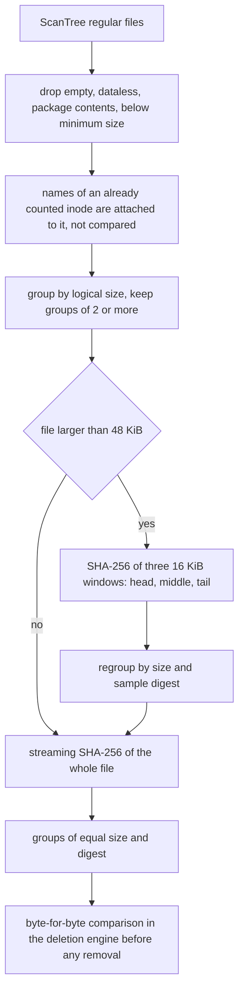
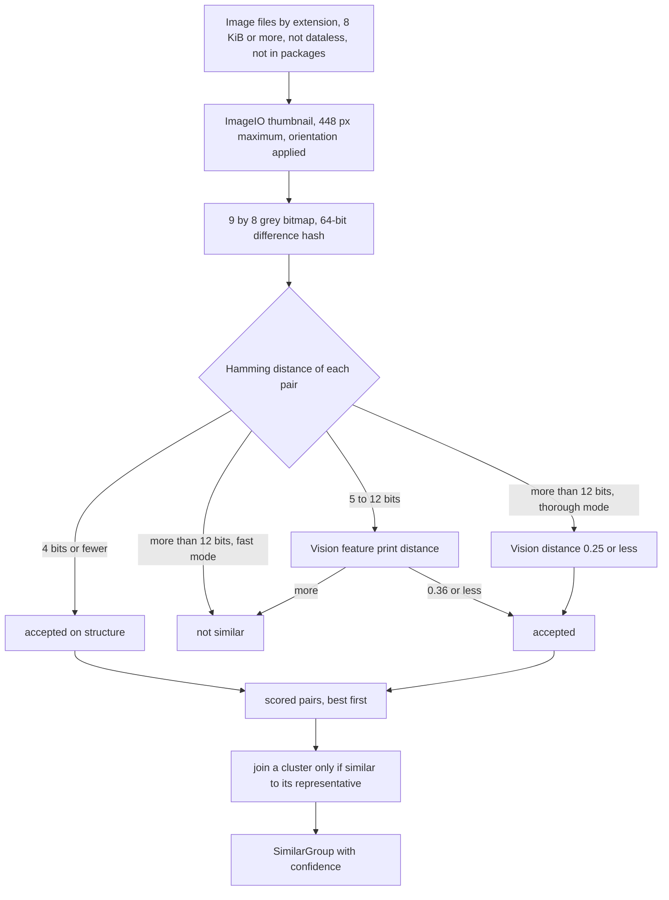

<!-- ORIX Clean / File: docs/architecture/duplicates.md / Author: Simon-Pierre Boucher / Contact: contact@spboucher.ai -->
# Duplicates and similar images

Two analyses run on a scanned tree. Exact duplicates are a proof of equality (SHA-256, then a byte comparison
before removal). Similar images are a perceptual judgement and are never treated as equal. Sources:
`DuplicateDetection/DuplicateFinder.swift`, `ImageSimilarity/SimilarImageFinder.swift`.

## Exact duplicates

### Pipeline

1. **Candidates by size.** `tree.forEachFile` collects regular files of at least `minimumSize` bytes (default 1;
   the application uses megabytes chosen by the user). Dataless files are skipped. Files inside packages are
   skipped unless `includePackageContents` is set. A node flagged `hardLinkDuplicate` is recorded under its
   file id as another name of the same inode and is not compared.
2. **Sampled hash.** For files larger than three sample windows, `sampleHash` reads 16 KiB at the head, the
   middle and the tail with `pread` and hashes them. This only splits size groups cheaply; it never decides.
3. **Full hash.** `fullHash` streams the file in 1 MiB chunks through CryptoKit `SHA256`. It opens with
   `O_NOFOLLOW`, requires a regular file, and returns nil if the size differs from the scanned size before or
   after reading, so a file that changed since the scan drops out.
4. **Groups.** Files with the same size and digest form a `DuplicateGroup`, with members sorted by path and
   groups sorted by redundant content.
5. **Verification at removal.** A duplicate `CleanupItem` carries `verifyAgainst`, the path of the copy that
   stays. `DeletionEngine` calls `identicalContents` (two `pread` streams and `memcmp`) immediately before
   moving the item, and skips it if the copies differ, if the kept copy is gone, if the kept copy is also
   selected, or if both paths are the same inode.

Both hashing functions set `F_NOCACHE` on the descriptor so that hashing a large tree does not fill the unified
buffer cache.

### Data structures

| Type | Content |
|---|---|
| `DuplicateFile` | node index, path, modification date, allocated size, private size, file id, `mayShareBlocks`, clone id, `hardLinkPaths` |
| `DuplicateGroup` | hexadecimal digest, logical size, files; `redundantLogical`, `sharesStorage`, `recoverable(removing:)` |
| `DuplicateResult` | groups, candidate count, bytes hashed, duration, unreadable paths, cancelled |
| `DuplicateProgress` | stage (`grouping`, `sampling`, `hashing`, `done`), files done and total, bytes hashed |

`redundantLogical` is `logicalSize * (count - 1)`: content held by the extra copies, not space that would be
freed. `sharesStorage` is true when two members have the same non-zero clone id or any member may share
blocks; the interface then says that removing a copy frees little. `recoverable(removing:)` returns a range
per the rules in `storage-accounting.md`.

### Concurrency

`parallelMap` starts up to `workers` dedicated threads at `.utility` quality of service. The default is half
the active processor count, clamped between 2 and 6. Workers pull indexes from a shared cursor and write
results into preallocated slots.

Measured on the sample folder: 685 MB hashed in 0.069 s with 6 threads. This is a **warm-cache** figure: the
files had just been written and were in memory. A cold run is bound by the read speed of the disk, not by
SHA-256.

### Invariants

- Two files are in the same group only if their full SHA-256 digests and sizes are equal. The sampled hash
  cannot create a group (test `collisionsInThePreliminaryFilterDoNotCreateFalseGroups` forces every sample to
  collide).
- Hard links of one inode are one file, never a duplicate pair, and are not offered for removal.
- A cancelled run returns no groups.
- The engine never removes the last copy of a group: the kept copy must exist, differ in inode and be
  identical at removal time.

### Failure handling

| Situation | Result |
|---|---|
| File cannot be opened or read | Dropped from its group; path listed in `DuplicateResult.unreadable` |
| File changed size since the scan | Full hash returns nil; file dropped |
| Sample read fails | File dropped before full hashing |
| Symlink in place of the file | Refused by `O_NOFOLLOW` |
| Cancel | Workers stop at the next file or chunk; empty result with `cancelled == true` |

### Not handled

- Duplicate folders as units; only files are compared.
- Files inside packages by default (parts of an application or a photo library are not independent files).
- Dataless files: comparing them would download them.
- Automatic choice of the copy to keep in the application; the user chooses with "keep only". In a workflow
  the first path of each group, in path order, is kept.
- Link names are attached by file id alone, which is sufficient within one device.

## Similar images

### Method

A 64-bit difference hash is the prefilter and Vision feature prints confirm. Clusters are built around a
representative image; similarity is not chained.

- **Fingerprint.** `fingerprint` creates a thumbnail with `CGImageSourceCreateThumbnailAtIndex`, draws it into
  a 9 by 8 grey context and compares each pixel with its right neighbour, giving 64 bits. Pixel dimensions come
  from the image properties, swapped for rotated orientations. Fingerprints are computed in parallel.
- **Vision.** `VNGenerateImageFeaturePrintRequest` runs on the same thumbnail with `.scaleFill`; the distance
  is the Euclidean distance between the float vectors, computed with `vDSP_distancesq`. In fast mode the
  vector is computed lazily, only for images that appear in a pair needing it. In thorough mode it is computed
  for every image and every pair is judged, which also finds crops; thorough mode is limited to 3,000 images
  and falls back to fast above that (`SimilarResult.mode` reports the mode actually used).
- **Clustering.** Accepted pairs are sorted by score. The first pair founds a cluster with one image as
  representative. Another image joins only if it has an accepted score with that representative. "A is like
  B and B is like C" does not put A and C together.
- **Confidence.** The weakest link score in the cluster, clamped to 0 through 1. The structural score is
  `1 - bits / 32`; the perceptual score is `1 - distance / 0.72`.

Supported extensions: jpg, jpeg, png, heic, heif, tiff, tif, gif, bmp, webp. Measured in fast mode on the
sample folder: 31 images in 0.21 s, about 150 images per second.

### Rules in the application

- Nothing is preselected. `AppModel.toggleSimilar` refuses to select the last remaining image of a group.
- A selected image is a `review`-risk item whose reason states that similar is not identical.
- There is no byte verification for similar images: they are different files by definition.

### Failure handling

- An image that cannot be decoded is counted in `SimilarResult.unreadable` and ignored (test
  `corruptImagesAreCountedNotCrashed`).
- If Vision returns no vector for an image, pairs that need it are rejected.
- A cancelled run returns no groups.

### Not handled

- RAW formats, videos, Live Photo pairs and bursts as such.
- Images inside photo libraries and other packages.
- Pair comparison is quadratic in the number of images; there is no index structure.
- Thresholds were chosen on generated test pictures and the sample folder, not on a labelled photo corpus.
