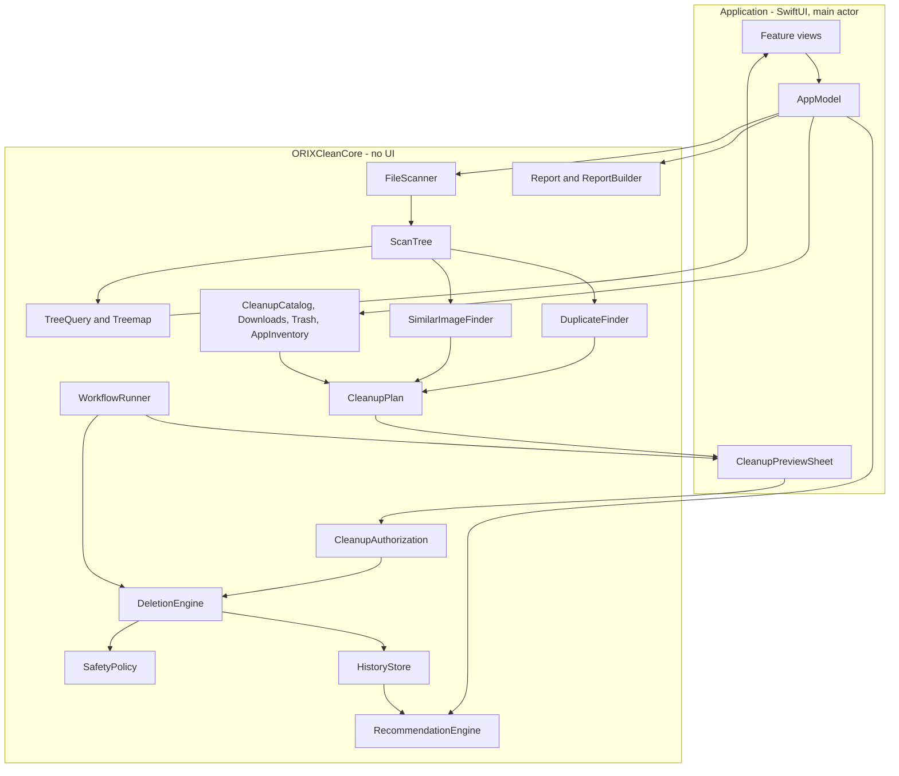
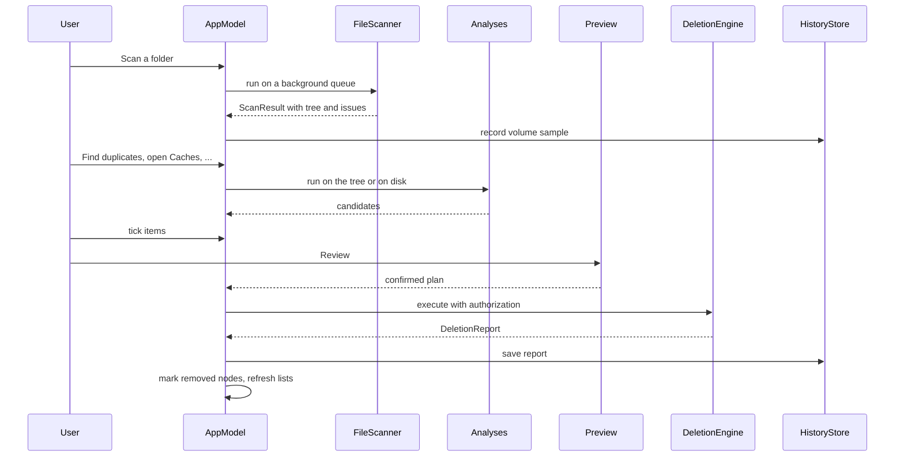

<!-- ORIX Clean / File: docs/architecture/overview.md / Author: Simon-Pierre Boucher / Contact: contact@spboucher.ai -->
# Architecture overview

ORIX Clean is a SwiftUI application on top of one Swift package, `ORIXCleanCore`, which holds every engine and
has no UI dependency. This document describes the split, the data flow and the parts that have no document of
their own: recommendations, reporting and Actions. Similar-image analysis is in `duplicates.md`.

## Layout

| Part | Location | Role |
|---|---|---|
| Core library | `Packages/ORIXCleanCore/Sources/ORIXCleanCore/` | Scanner, accounting, duplicates, image similarity, cleanup planning, deletion, applications, recommendations, persistence, reporting, workflows |
| Bench and fixture CLI | `Packages/ORIXCleanCore/Sources/orix-bench/` | `scan`, `dupes`, `similar`, `treemap`, `sample`, `fixture` |
| Core tests | `Packages/ORIXCleanCore/Tests/ORIXCleanCoreTests/` | Swift Testing suites on temporary folders and disk images |
| Application | `App/Sources/` | `App/` (model, root view, entry point), `DesignSystem/`, `Features/*` |
| UI tests | `UITests/ORIXCleanUITests.swift` | XCUITest scenarios on a disposable disk image |
| Project | `project.yml` | XcodeGen definition; the `.xcodeproj` is generated |

Build settings that shape the architecture: Swift 6 language mode with complete strict concurrency, the
application target defaulting to `MainActor` isolation, macOS 15.0 minimum, Hardened Runtime, no sandbox, empty
entitlements, universal Release build.

## Components

## State and threading

`AppModel` is a single `@Observable` object on the main actor. It owns the current `ScanResult`, the results of
each analysis, the cleanup selection (`basket`, keyed by path), the open preview request and the history
arrays. Views read it through the SwiftUI environment.

Engines are blocking classes marked `@unchecked Sendable` with their own lock. The model runs them on
`DispatchQueue.global(qos: .userInitiated)` through a checked continuation and never blocks the main thread.
Progress is polled, not pushed: a 0.12 s timer copies `scanner.progress`, `duplicateFinder.progress` and
`similarFinder.progress` into observable properties and stops itself when nothing is running. Every counter
shown during a scan is a real counter from the engine.

| Engine | Threads | Cancellation |
|---|---|---|
| `FileScanner` | 3 dedicated threads by default (1 under thermal pressure or Low Power Mode) | `cancel()`, `pause()`, `resume()` |
| `DuplicateFinder` | 2 to 6 dedicated threads, half the active cores | `cancel()`; a cancelled run returns no groups |
| `SimilarImageFinder` | `DispatchQueue.concurrentPerform` for fingerprints, serial comparison | `cancel()`; a cancelled run returns no groups |
| `DeletionEngine` | caller's thread, one item at a time | `cancel()`; remaining items are recorded as skipped |

`treeVersion` is an integer the model increments whenever the tree changes (new scan, items removed) so that
views that draw from the tree recompute.

## Lifecycle of a session

After a cleanup, `AppModel.absorb` removes the affected paths from every list, calls `ScanTree.markRemoved` so
totals stay consistent without a rescan, reloads the Trash and records a new volume sample.

## Recommendations

`RecommendationEngine.evaluate(Findings)` is a pure function. `Findings` holds optional results; nil means
"not analysed yet" and produces nothing. Each recommendation carries its evidence sentence, paths, measured
size, risk, consequence and destination section. Results are sorted by measured size.

| Id | Condition in the code | Risk |
|---|---|---|
| `low-space-<volume>` | writable volume with less than 10 % free | low |
| `growth-<volume>` | at least 3 samples over 6 hours, slope above 0.5 GB per day, projected under 60 days of free space | low |
| `duplicates` | redundant content of 200 MB or more | review |
| `deriveddata` | DerivedData candidates total 5 GB or more | low |
| `old-archives` | Xcode archives older than 180 days total 1 GB or more | review |
| `caches` | low-risk cache and log candidates total 2 GB or more | low |
| `old-installers` | installers and disk images added more than 90 days ago total 500 MB or more | review |
| `partial-downloads` | incomplete downloads total 100 MB or more | review |
| `trash` | Trash content of 1 GB or more | review |

The growth figure is a least-squares slope (`Trend.bytesPerDay`) over samples that exist only while the
application was open; the text says it is a projection, not a forecast.

## Reporting

`Report` is a `Codable` value: title, generation date, scope, limitations and sections of facts and rows.
`ReportBuilder` produces sections from engine results (overview, largest files, duplicates, similar images,
candidates, cleanup results, trends) and `limitations(issues:fullDiskAccess:sharingMeasured:)` writes what the
scan could not see. Renderers:

| Format | Implementation | Notes |
|---|---|---|
| Markdown | string builder | Escapes `\|` and newlines in table cells |
| CSV | string builder, CRLF | Every field quoted; a leading `=`, `+`, `-`, `@`, tab or CR is prefixed with `'` to neutralize spreadsheet formulas |
| JSON | `JSONEncoder`, sorted keys, ISO 8601 dates | The `Report` value itself |
| PDF | Core Graphics and Core Text | US Letter (612 by 792 points), paginated text with a footer; table rows are text lines, not drawn grids |

Exports go through `NSSavePanel`, or to the directory given by `-ORIXExportDir` in tests.

## Actions

An Action is a saved `Workflow`: an ordered list of `WorkflowStep` values (`scanFolder`, `findDuplicates`,
`collectCaches`, `collectDeveloperData`, `collectDownloads`, `review`, `moveToTrash`, `report`). Four are built
in; user workflows are stored as JSON documents in the history database.

`Workflow.validate()` enforces the product rule that removal happens only right after review: a `moveToTrash`
step is valid only if a `review` step precedes it with no scan or collection step in between, and each review
covers one removal. `WorkflowRunner` executes the steps, hands the plan to a `WorkflowReviewer` at each review
step, and removes only what that reviewer returned. In the application the reviewer is the cleanup preview
sheet; declining it ends the workflow with nothing removed. Collection steps in a workflow keep only low-risk
catalogue items. Details are in `cleanup.md`.

## Localization

Every UI string is written as `L("English")` (`StorageAccounting/Support.swift`); the English text is the key.
`Scripts/localize.py` extracts the keys from both source trees and writes `App/Resources/Localizable.xcstrings`
with `en` and `fr-CA` from `Scripts/translations-fr.json` (683 keys), failing when a key has no translation or
when placeholders differ. Numbers, sizes and dates are formatted through `ByteFormat` with the current locale.

## Invariants

- The core package imports no UI framework and contains no network code.
- Nothing is removed without a `CleanupAuthorization` created by the preview's confirm action.
- Every figure shown or exported comes from a measurement or a deletion record.
- The scan tree is the only copy of scan results and lives in memory.

## Not handled

- No background agent, scheduler or menu-bar item: nothing runs when the window is closed.
- No incremental rescan or filesystem-event monitoring; a rescan walks the whole root again.
- One scan at a time; a new scan replaces the previous tree and clears duplicate and similar-image results.
- No automatic updater, no crash reporter, no telemetry.
- Errors of the history store are swallowed (`AppModel.store` is optional and writes are best effort).
