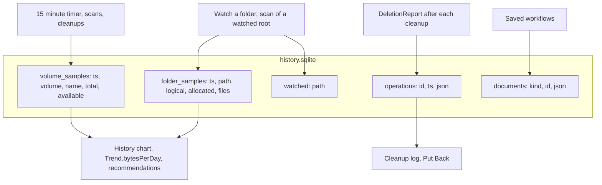
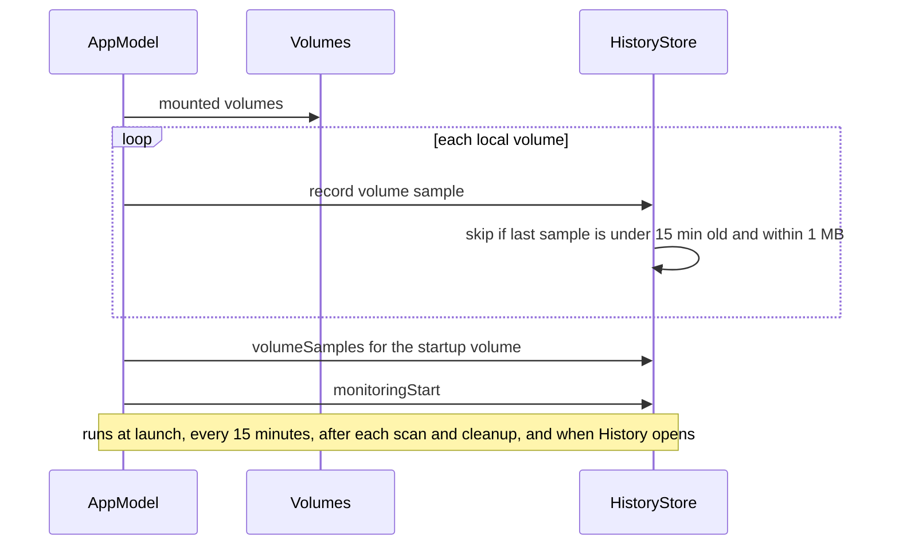

<!-- ORIX Clean / File: docs/architecture/persistence.md / Author: Simon-Pierre Boucher / Contact: contact@spboucher.ai -->
# Persistence

ORIX Clean persists very little: volume samples, watched-folder samples, the cleanup log and saved workflows,
in one SQLite file, plus a handful of interface preferences in the user defaults. Scan results are never
written to disk. Source: `Persistence/HistoryStore.swift`.

## Design decisions

| Decision | Rationale |
|---|---|
| Plain SQLite through the C API (`import SQLite3`) | The schema is five small tables. The store lives in the core Swift package and is tested there without an application host. No model versioning or migration machinery is needed |
| Not SwiftData | SwiftData would tie persistence to the application target and add a migration layer for a schema this small |
| Scan results in memory only | A tree is a snapshot that goes stale immediately; storing file names and sizes on disk would create a private index of the user's files with no benefit over rescanning |
| JSON blobs for reports and workflows | They are `Codable` values read back whole; no query needs their fields |

## Location

`HistoryStore.defaultPath()` returns `~/Library/Application Support/ORIX Clean/history.sqlite`. The directory
is created on first open. The database runs in WAL mode, so `history.sqlite-wal` and `history.sqlite-shm`
appear next to it while it is open. Passing `nil` as the path opens an in-memory store; the application does
this when launched with `-ORIXStore memory` (UI tests, screenshots).

## Schema

| Table | Columns | Key or index | Written by |
|---|---|---|---|
| `volume_samples` | `ts REAL`, `volume TEXT`, `name TEXT`, `total INTEGER`, `available INTEGER` | index on `(volume, ts)` | `record(volume:at:minimumInterval:)` |
| `folder_samples` | `ts REAL`, `path TEXT`, `logical INTEGER`, `allocated INTEGER`, `files INTEGER` | index on `(path, ts)` | `record(folder:measurement:at:)` |
| `watched` | `path TEXT` | primary key | `watch`, `unwatch` |
| `operations` | `id TEXT`, `ts REAL`, `json BLOB` | primary key `id` | `save(_ report:)` with `INSERT OR REPLACE` |
| `documents` | `kind TEXT`, `id TEXT`, `json BLOB` | primary key `(kind, id)` | `saveDocument`, `deleteDocument` |

All tables are created with `CREATE TABLE IF NOT EXISTS` when the store opens. Timestamps are seconds since
1970. `volume` is the volume UUID, or its path when it has none. `operations.json` is a JSON-encoded
`DeletionReport`; the only `documents.kind` in use is `workflow`.

## What is recorded, and when

- **Volume samples.** `AppModel.refreshEnvironment` records one sample per non-network volume. The store drops
  a sample when the previous one for that volume is less than `minimumInterval` (900 s) old and the available
  space changed by less than 1 MB. Samples exist only for periods when the application was open; the History
  view and the trends report state this, and `monitoringStart()` gives the date of the first sample.
- **Folder samples.** A watched folder is measured when it is added, when the user asks to measure watched
  folders, and when a scan's root is a watched path.
- **Operations.** Every `DeletionReport` is saved after a cleanup and saved again when a record is marked
  restored. `operations(limit:)` returns the 200 most recent by default.
- **Workflows.** User-defined Actions; built-in ones are code and are not stored.

`Trend.bytesPerDay` computes a least-squares slope of used space over the samples and returns nil with fewer
than 3 samples or less than 6 hours between the first and the last.

## What is not in the database

| Data | Where it lives |
|---|---|
| Scan tree, file names, file sizes | Memory, for the lifetime of the scan |
| Duplicate and similar-image results | Memory |
| Cleanup selection (basket) | Memory |
| Appearance, list density, map palette, size kind, package contents toggle, onboarding flag | User defaults of the application (`appearance`, `density`, `mapPalette`, `sizeKind`, `showPackageContents`, `onboarded`) |
| Exported reports | Wherever the user saves them |

The cleanup log does contain file paths: each `DeletionRecord` stores the original path, the Trash path,
sizes, status and detail text. Watched-folder paths and workflow scan paths are stored as well.

## Concurrency

One connection, opened with `SQLITE_OPEN_FULLMUTEX`, and an `NSLock` around every prepared statement. Each
write is a single statement. Text and blob bindings use `SQLITE_TRANSIENT`, so SQLite copies them.

## Invariants

- The store never contains more than what the tables above describe; there is no table for scan content.
- A report id is unique: saving a report with an existing id replaces it.
- `watched.path` is unique; watching twice is a no-op.
- Samples are append-only apart from "Erase History".

## Failure handling

- If the store cannot be opened, `AppModel.store` is nil and the application runs without history; nothing
  else depends on it.
- A statement that fails to prepare returns an empty result; write errors are not surfaced to the user.
- A JSON blob that no longer decodes is skipped when reading operations or documents.

## Erasing

Settings > Privacy & Access > Erase History calls `eraseAll()`, which deletes all rows of `volume_samples`,
`folder_samples` and `operations` after a confirmation dialog. It does not delete the `watched` list or saved
workflows, and it does not remove the database file. Deleting the `ORIX Clean` folder in Application Support
while the application is closed removes everything.

## Not handled

- No schema version and no migration path; a future schema change will need one.
- No retention limit, pruning or `VACUUM`: samples accumulate at up to one per volume per 15 minutes of use.
- No encryption beyond what the user's disk provides.
- `record(volume:)` loads all samples of the volume to find the last one, which is linear in history length.
- `VolumeSample.id` is the timestamp alone; it is unique per volume, which is how the application uses it.
