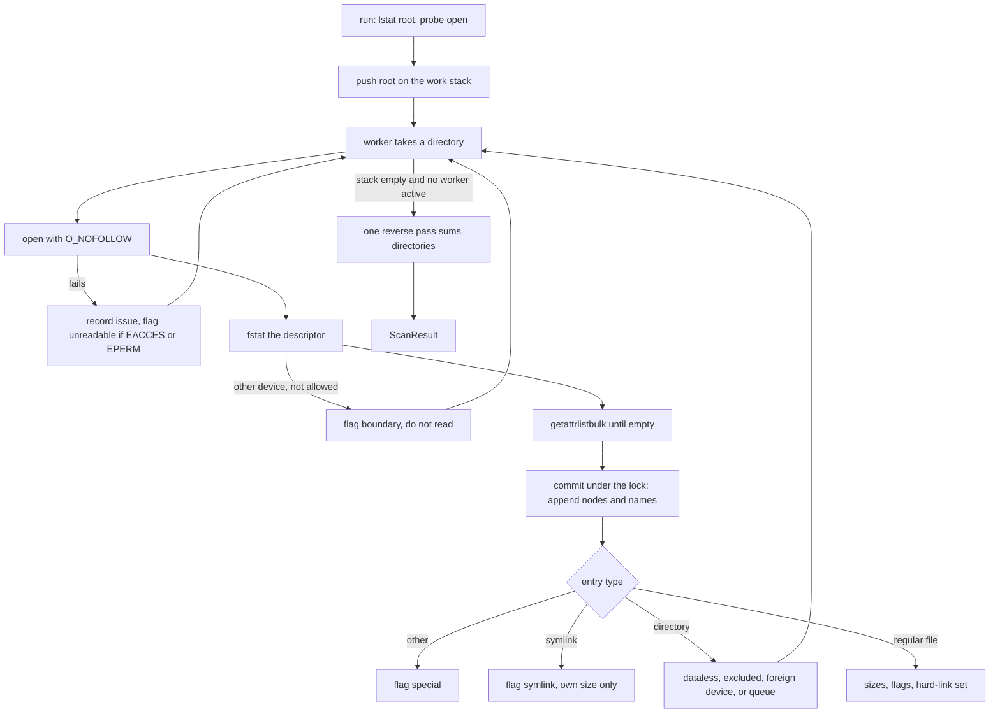

<!-- ORIX Clean / File: docs/architecture/scanner.md / Author: Simon-Pierre Boucher / Contact: contact@spboucher.ai -->
# Scanner

The scanner turns a directory into a `ScanTree`: one fixed-size record per filesystem object, with sizes
aggregated up to the root. Sources: `FileScanner/DirectoryReader.swift`, `FileScanner/FileScanner.swift`,
`FileScanner/ScanTree.swift`.

## Design decisions

| Decision | Rationale |
|---|---|
| `getattrlistbulk(2)` instead of `readdir` plus `stat`, or `FileManager` enumeration | One system call returns names and all needed attributes for many entries. It is also the only bulk route to the APFS private size, clone id and extended flags |
| Never follow symbolic links | A link is recorded as a link with its own size. Loops cannot occur and nothing outside the root is counted |
| Mount points detected by `fstat` of the opened directory | The directory entry describes the covered folder; the open descriptor describes what is mounted on it |
| Hard links counted once | Totals must match what the volume actually stores |
| Dataless files never read | Reading an evicted iCloud or File Provider item would download it |
| Dedicated threads, default 3 | Enumeration is bound by the filesystem, not by cores (see `docs/development/performance.md`) |
| Arena of 64-byte records | Predictable memory, cache-friendly aggregation, cheap `Sendable` hand-off |

## Reading one directory

`DirectoryReader.open` opens with `O_RDONLY | O_DIRECTORY | O_NOFOLLOW | O_CLOEXEC`. If `open` fails with
`ENAMETOOLONG`, the path is walked component by component with `openat` from `/`; only the last component
refuses symlinks, as `open(2)` itself does.

`DirectoryReader.read` calls `getattrlistbulk` in a loop on a 256 KiB buffer owned by the worker thread.

### Attributes requested

| Group | Attributes |
|---|---|
| `commonattr` | `ATTR_CMN_RETURNED_ATTRS`, `ATTR_CMN_ERROR`, `ATTR_CMN_NAME`, `ATTR_CMN_DEVID`, `ATTR_CMN_OBJTYPE`, `ATTR_CMN_MODTIME`, `ATTR_CMN_FLAGS`, `ATTR_CMN_FILEID` |
| `dirattr` | `ATTR_DIR_MOUNTSTATUS` |
| `fileattr` | `ATTR_FILE_LINKCOUNT`, `ATTR_FILE_TOTALSIZE`, `ATTR_FILE_ALLOCSIZE` |
| `forkattr` with `FSOPT_ATTR_CMN_EXTENDED` | `ATTR_CMNEXT_PRIVATESIZE`, `ATTR_CMNEXT_CLONEID`, `ATTR_CMNEXT_EXT_FLAGS` |

### Order in the returned buffer

Each entry starts with a `UInt32` length. The parser then reads, in this order, only the attributes present in
the returned set:

| # | Field | Size in bytes | Stored as |
|---|---|---|---|
| 1 | entry length | 4 | advance cursor |
| 2 | `attribute_set_t` returned attributes | 20 | presence mask |
| 3 | error | 4 | `RawEntry.error` |
| 4 | name reference `attrreference_t` | 8 | offset and length; bytes copied without the trailing NUL |
| 5 | device id | 4 | `device` |
| 6 | object type | 4 | `objType`: 1 regular, 2 directory, 5 symlink |
| 7 | modification time `timespec` | 16 | seconds only |
| 8 | BSD flags | 4 | `SF_DATALESS`, `UF_COMPRESSED` |
| 9 | file id | 8 | inode number |
| 10 | mount status, directories | 4 | `mountStatus` |
| 11 | link count, files | 4 | `linkCount` |
| 12 | total size, files | 8 | `logicalSize` |
| 13 | allocated size, files | 8 | `allocatedSize` |
| 14 | private size | 8 | `privateSize`, -1 when absent |
| 15 | clone id | 8 | `cloneID` |
| 16 | extended flags | 8 | `EF_MAY_SHARE_BLOCKS`, `EF_IS_SPARSE` |

All loads are unaligned. If the first call fails with `EINVAL` or `ENOTSUP` while extended attributes were
requested, the directory is read again without them; `ScanResult.sharingMeasured` is true only if at least one
regular file reported a private size.

## Traversal

Shared state (work stack, tree, issue list, counters, the two "seen" sets) is guarded by one `NSCondition`.
Workers read directories without the lock and take it only to pop work and to commit a whole batch. The stack
is LIFO, so traversal is depth-first per worker. A worker exits when the stack is empty and no other worker is
active, or on cancellation. Threads use `.userInitiated` quality of service and a 1 MiB stack.

Rules applied to each entry at commit:

- **Directory**: flagged `package` when its extension is in `PackageTypes.extensions` (packages are still
  traversed). It is not queued when it is dataless, listed in `excludedPaths` (`skipped`), on a device other
  than the root and not in `allowedDevices` (`boundary`), reported with an error, or already seen. The seen set
  is keyed by device and file id.
- **Regular file**: counted; sizes copied; flags `dataless`, `compressed`, `mayShareBlocks`, `sparse` set from
  the kernel flags. A clone id is stored in `tree.cloneIDs` only when the file may share blocks. With a link
  count above 1 the file is `hardLinked`, and every name after the first seen is also `hardLinkDuplicate`.
- **Symlink**: flagged, its own logical and allocated size kept, never queued.
- **Anything else** (socket, FIFO, device): flagged `special`, size zero.

`ScanOptions.startupVolume()` is used for `/`: it allows the device of `/System/Volumes/Data` and excludes
`/System/Volumes`, `/Volumes`, `/dev` and `/.vol`, so the firmlinked data is counted once.

## Data structures

`ScanNode` is 64 bytes:

| Field | Type | Bytes | Meaning |
|---|---|---|---|
| `nameOffset` | `UInt32` | 4 | Offset in the shared name buffer |
| `nameLength` | `UInt16` | 2 | UTF-8 length |
| `flags` | `NodeFlags` (`UInt16`) | 2 | 14 flags, see below |
| `parent` | `Int32` | 4 | -1 for the root |
| `childStart` | `Int32` | 4 | Index of the first child |
| `childCount` | `Int32` | 4 | Children are contiguous |
| `fileCount` | `UInt32` | 4 | Regular files below; 1 for a file |
| `logicalSize` | `Int64` | 8 | Content bytes |
| `allocatedSize` | `Int64` | 8 | Bytes allocated on disk |
| `privateSize` | `Int64` | 8 | APFS private size; -1 when not reported |
| `modified` | `Int64` | 8 | Seconds since 1970 |
| `fileID` | `UInt64` | 8 | Inode number |

`NodeFlags`: `directory`, `symlink`, `package`, `hardLinked`, `hardLinkDuplicate`, `mayShareBlocks`, `sparse`,
`dataless`, `unreadable`, `boundary`, `compressed`, `special`, `removed`, `skipped`.

`ScanTree` holds `nodes: [ScanNode]`, `names: [UInt8]` (all names back to back, no terminators),
`cloneIDs: [Int32: UInt64]`, `rootPath` and `rootDevice`. Paths are rebuilt on demand by walking parents.

## Invariants

- Index 0 is the root. The children of a directory are contiguous and always have a larger index than their
  parent; `aggregate()` relies on this to sum every directory in one reverse pass.
- A `hardLinkDuplicate` node contributes its `fileCount` but no bytes to any total.
- A directory's `privateSize` is the sum of positive private sizes below it, hence a lower bound.
- After `run()` returns, the tree is read-only except for `markRemoved`, which must not run while an analysis
  reads the tree. `markRemoved` flags the subtree and subtracts its totals from every ancestor.
- The running `allocatedBytes` progress counter excludes hard-link duplicates.

## Failure handling

| Situation | Result |
|---|---|
| Root missing, not a directory, or unreadable | `ScanError.rootNotFound`, `.rootNotDirectory`, `.rootUnreadable(path, errno)` thrown before any thread starts |
| Directory cannot be opened | `ScanIssue` with kind from errno: `permissionDenied` (`EACCES`, `EPERM`), `vanished` (`ENOENT`, `ENOTDIR`), `pathTooLong`, otherwise `ioError`; node flagged `unreadable` for permission errors; scan continues |
| Read fails part-way | Issue recorded; entries already returned are kept |
| Per-entry error from the kernel | Issue recorded for that entry; a directory with an error is not queued |
| Tree would exceed `Int32` node indexes or `UInt32` name bytes | Issue with `EOVERFLOW` for that directory; its entries are dropped |
| Cancel | Workers stop taking work; aggregation still runs; `ScanResult.cancelled` is true |
| Pause | Workers finish their current directory and wait on the condition |

The application discards a cancelled result and keeps the previous tree.

## Not handled

- Directory hard links and firmlink subtleties beyond the device and file id check.
- Extended attributes and resource forks as separate items; `ATTR_FILE_TOTALSIZE` already includes all forks.
- Sizes of directories themselves (zero on APFS; filesystems that allocate blocks for directories are
  under-counted by that amount).
- Names longer than 65,535 bytes are truncated to that length in the arena.
- No incremental update: a rescan rebuilds the whole tree.
- Filesystems other than APFS were exercised only as far as the fallback path compiles; see the "not measured"
  list in `docs/development/performance.md`.
