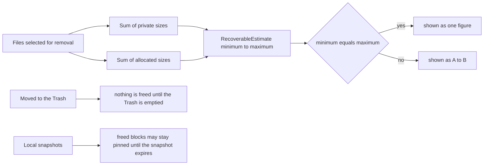

<!-- ORIX Clean / File: docs/architecture/storage-accounting.md / Author: Simon-Pierre Boucher / Contact: contact@spboucher.ai -->
# Storage accounting

How ORIX Clean counts bytes, why it keeps three sizes per file, and why the space a cleanup is expected to
return is given as a range. Sources: `StorageAccounting/Support.swift`, `Volumes.swift`, `Queries.swift`,
`Treemap.swift`, and the size fields filled by the scanner.

## Three sizes

| Size | Field | Kernel source | Question it answers |
|---|---|---|---|
| Logical ("content size") | `logicalSize` | `ATTR_FILE_TOTALSIZE` | How many bytes of content does the file hold, all forks included? |
| Allocated ("size on disk") | `allocatedSize` | `ATTR_FILE_ALLOCSIZE` | How many bytes of blocks are attributed to this file? |
| Private | `privateSize` | `ATTR_CMNEXT_PRIVATESIZE` | How many bytes would the volume get back if this file alone were removed? -1 when the filesystem does not say |

For a single file measured outside a scan, `Measure.item` uses `lstat` (`st_size`, `st_blocks * 512`) and
`getattrlist` with `ATTR_CMNEXT_PRIVATESIZE` and `FSOPT_NOFOLLOW`. For a directory it runs a two-thread scan
and reads the root totals; `incomplete` is set when that scan reported any issue, in which case the sizes are a
lower bound.

The interface lets the user choose which size drives the map and lists (`SizeKind.allocated`, the default, or
`.logical`); it shows both in detail views. Sizes are formatted with decimal units, as Finder does
(`ByteFormat.string`, `.byteCount(style: .file)`).

## Why the three differ

| Case | Logical vs allocated | Private | How the code represents it |
|---|---|---|---|
| Ordinary file | Allocated is logical rounded up to the block size | Equal to allocated | No flag |
| **APFS clone** (copy made by Finder, `cp -c`, `clonefile`) | Each clone reports its full allocated size | Close to zero while blocks are shared; grows as either copy is modified | `mayShareBlocks` from `EF_MAY_SHARE_BLOCKS`; clone id kept in `tree.cloneIDs` |
| **Hard link** (several names, one inode) | Every name reports the same sizes | Not meaningful per name | `hardLinked` on all names; `hardLinkDuplicate` on every name after the first seen, which then adds nothing to totals |
| **Sparse file** | Allocated is far below logical | Follows allocated | `sparse` from `EF_IS_SPARSE` |
| **Compressed file** (transparent compression) | Allocated can be far below logical | Follows allocated | `compressed` from `UF_COMPRESSED` |
| **Dataless file** (evicted iCloud or File Provider item) | Logical is the full size, allocated near zero | Near zero | `dataless` from `SF_DATALESS`; never opened for reading |
| File also referenced by a **local snapshot** | Unchanged | Blocks pinned by a snapshot are not private | No dedicated flag; the file may show `mayShareBlocks` |

Consequences enforced in code:

- Directory totals sum logical, allocated and positive private sizes of descendants, skipping hard-link
  duplicates, so a folder with three names of one 300 kB file reports 300 kB (test `hardLinksAreCountedOnce`).
- A directory's private total is a lower bound: blocks shared only between two files of the same folder are
  private to the folder but to neither file.
- The treemap skips hard-link duplicates and zero-size children, so areas add up to the parent's total.
- Category totals (`TreeQuery.categories`) skip hard-link duplicates; files inside a package are attributed
  to the package's category (an `.app` to Applications).

## Recoverable space is a range

`RecoverableEstimate` has a `minimum` and a `maximum`:

- **Maximum** is the sum of allocated sizes. It is reached only if nothing in the selection shares blocks with
  a file that stays.
- **Minimum** is the sum of private sizes: what the filesystem attributes to these files alone. When private
  size is unknown (-1), the allocated size is used for both ends and the estimate is exact but possibly
  overstated; reports say so in their limitations.
- In a duplicate group, a member that has other hard-linked names contributes zero to both ends
  (`DuplicateGroup.recoverable(removing:)`): removing one name frees nothing.

A single figure cannot be correct in general. If two clones are both selected, the truth is near the maximum;
if only one is, it is near the minimum; private sizes are per file and do not tell which blocks are shared
with which other file. The range states what is known. The estimate is also only about the files: the volume
gets the space back when the Trash is emptied, and blocks still referenced by a local snapshot stay in use
until the snapshot is deleted by the system. The cleanup results show free space reported by macOS before and
after, without claiming the difference is due to the cleanup.

## Volumes, free space and purgeable space

`Volumes.mounted()` lists mounted volumes (hidden ones skipped) with `URLResourceValues` and `statfs`.

| Field | Source | Meaning |
|---|---|---|
| `total` | `.volumeTotalCapacityKey` | Capacity |
| `available` | `.volumeAvailableCapacityKey` | Free blocks reported right now |
| `availableForImportantUsage` | `.volumeAvailableCapacityForImportantUsageKey`, never below `available` | What the system says it could make available |
| `purgeable` | difference of the two above | Space the system could reclaim on demand |
| `format` | `statfs.f_fstypename` | Filesystem type |
| `isReadOnly` | resource value or `MNT_RDONLY`; forced false for `/` | The startup volume is a sealed snapshot, but the Data volume behind it is writable |

Purgeable space is reported, not managed: it is whatever macOS considers reclaimable (caches it controls,
local snapshots). The application cannot list it, attribute it to files or purge it. Used space is
`total - available`, so on APFS it includes space used by other volumes of the same container; the figure is
the system's, shown as such.

Snapshots are not enumerated (see `docs/research/macos-storage-capability-matrix.md`). Their effect appears
only indirectly, in purgeable space and in the limitation text of reports.

## Queries on the tree

| Function | Behaviour |
|---|---|
| `TreeQuery.largestFiles` | One pass over files with a fixed-capacity min-heap (default 500). Filters: size bounds, modified before or after, categories, extensions, case-insensitive name substring, subtree. Files inside packages are excluded unless asked |
| `TreeQuery.largestFolders` | Depth-first walk; packages count as one item and are not descended into |
| `TreeQuery.categories` | Totals per `FileCategory` (video, audio, image, archive, disk image, installer, document, code, application, other) from a fixed extension table |
| `Treemap.layout` | Squarified layout (Bruls, Huizing, van Wijk) with level of detail |

### Treemap level of detail

The map is drawn with SwiftUI `Canvas`, not Metal. `Treemap.layout` produces only what can be seen:

- a folder is opened only if its rectangle is at least 26 points on each side and depth is under 7;
- packages are leaves unless the user enables package contents (the layout root is always opened);
- children whose area would be under 14 square points are merged into one "smaller items" cell that carries
  the count and total size of what it stands for;
- with a `visible` rectangle, subtrees that do not intersect the viewport are skipped (zoom and pan).

Measured on a 467,907-node tree at 1600 by 1000: 1,798 cells in 0.162 ms on average. With a layout this cheap
and a cell count this small, a custom Metal renderer was not justified.

## Invariants

- No size is estimated from a name or an extension; categories are the only thing derived from extensions.
- `RecoverableEstimate.minimum <= maximum` (the initializer clamps).
- Totals shown for a folder equal the sum over its regular files (checked under concurrent modification by the
  test `filesChangingAndDisappearingDuringScan`).
- Allocated total of a scan matched `du -sk` exactly on the test tree and on a 31k-object tree.

## Failure handling

- Unreadable folders have unknown size: they contribute nothing and are listed as issues.
- A filesystem that rejects the extended attributes yields `sharingMeasured == false`; private sizes are then
  treated as unknown everywhere.
- Volumes with zero capacity or unreadable resource values are omitted.

## Not handled

- Which file shares blocks with which: only "may share" and a clone id per file are known.
- Space used by snapshots, by other volumes of the same APFS container, or by the system's own purgeable data.
- Per-file accounting on non-APFS filesystems beyond logical and allocated size.
- Directory entries' own blocks.
