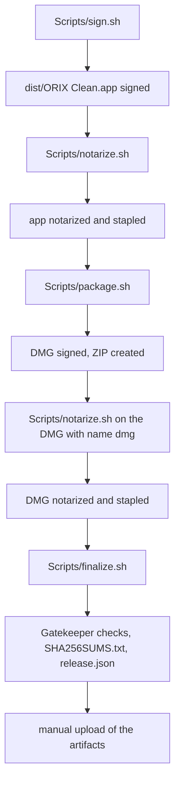

<!-- ORIX Clean / File: docs/release/distribution.md / Author: Simon-Pierre Boucher / Contact: contact@spboucher.ai -->
# Distribution

How the distributable artifacts are built by `Scripts/package.sh` and checked by `Scripts/finalize.sh`, what
they contain, and how users receive updates.

This document describes a procedure. It does not state that any version has been packaged or published.

## Channel

ORIX Clean is distributed directly, outside the Mac App Store, as a Developer ID signed and notarized
application. The Mac App Store is not a possible channel for this design: the application is not sandboxed,
because it measures folders the user points it at across the whole disk.

| Artifact | Name | Purpose |
|---|---|---|
| Disk image | `dist/ORIXClean-<version>.dmg` | Primary download: drag-to-Applications window |
| ZIP archive | `dist/ORIXClean-<version>.zip` | Alternative download, same stapled application |
| Checksums | `dist/SHA256SUMS.txt` | SHA-256 of the two files above |
| Metadata | `dist/release.json` | Version, build, minimum macOS, architectures, artifact sizes and hashes, notary submission ids |

Requirements stated to users: macOS 15.0 or later; Apple silicon or Intel (universal binary). The application
has been run on macOS 27.0 on Apple silicon only; see `docs/development/performance.md`.

## Release sequence



```sh
Scripts/sign.sh
Scripts/notarize.sh
Scripts/package.sh
Scripts/notarize.sh dist/ORIXClean-<version>.dmg dmg
Scripts/finalize.sh
```

Each script stops on the first error (`set -euo pipefail`). Signing and notarization are described in
`signing.md` and `notarization.md`.

## Packaging (`Scripts/package.sh`)

1. Requires `dist/ORIX Clean.app` and requires it to be stapled (`xcrun stapler validate`); otherwise it stops
   and points to `Scripts/notarize.sh`.
2. Reads the version and build number from the bundle's `Info.plist`.
3. Reads the signing identity from the application's own signature (the `Authority=Developer ID Application: …`
   line), so the disk image is signed by the same identity without naming it in the script.
4. Deletes any previous DMG and ZIP of that version.
5. Draws the background with `swift Scripts/dmg-background.swift` into `build/dmg-background.png`: 660 by 420
   points at 2x, dark gradient, "ORIX Clean", the tagline, an arrow and "Drag ORIX Clean to the Applications
   folder".
6. Copies the application to a temporary staging folder with `ditto` and builds the image with `create-dmg`:

   | Property | Value |
   |---|---|
   | Volume name | `ORIX Clean <version>` |
   | Window | 660 by 420 at position 200, 140 |
   | Icon size | 128 |
   | Application icon | at 170, 205, extension hidden |
   | Applications shortcut | at 490, 205 |

   If `create-dmg` fails, the script falls back to a plain compressed image made with `hdiutil create`
   (`UDZO`) containing the application and an `Applications` symlink, without the artwork, and says so on
   standard error.
7. Signs the image: `codesign --force --timestamp --sign "<identity>" <dmg>`.
8. Creates the ZIP from the stapled application with `ditto -c -k --keepParent`.
9. Prints the artifact names and reminds that the DMG must be notarized next.

The image is signed but not yet notarized when this script ends.

## Final verification (`Scripts/finalize.sh`)

Run after the disk image has been notarized and stapled.

| Step | Command used | Stops the script when |
|---|---|---|
| Gatekeeper on the application | `spctl --assess --type execute --verbose=2` | the assessment is rejected |
| Gatekeeper on the image | `spctl --assess --type open --context context:primary-signature --verbose=2` | rejected |
| Tickets | `xcrun stapler validate` on the application and on the image | a ticket is missing |
| ZIP content | extract with `ditto -x -k` to a temporary folder, then `spctl` and `stapler validate` on the extracted application | rejected or missing |
| Checksums | `shasum -a 256` of the DMG and the ZIP into `dist/SHA256SUMS.txt` | |
| Metadata | writes `dist/release.json` | |

`release.json` contains the name, bundle identifier, version, build, minimum macOS version, the architectures
reported by `lipo`, a signing description, the two notary submission ids read from `build/notary/app.json` and
`build/notary/dmg.json`, and for each artifact its file name, size in bytes and SHA-256.

Two caveats when reading that file:

- The notarization `status` fields are copied from the notary answers saved in `build/notary/app.json` and
  `dmg.json` (`unknown` when a file is missing). The independent proof remains `xcrun notarytool info <id>`.
- The submission ids are empty strings if `build/notary/*.json` is missing, for example after cleaning
  `build/`.

## Verifying a download

For anyone who received the artifacts:

```sh
shasum -a 256 -c SHA256SUMS.txt
spctl --assess --type open --context context:primary-signature --verbose=2 ORIXClean-<version>.dmg
xcrun stapler validate ORIXClean-<version>.dmg
codesign -dvv "/Volumes/ORIX Clean <version>/ORIX Clean.app"
```

The checksum proves the file is the one that was built; the other three prove who signed it and that Apple
notarized it.

## Installation and removal

- Install: open the disk image and drag **ORIX Clean** to **Applications**.
- First launch: the standard Gatekeeper dialog for a downloaded application. Then the onboarding sheet;
  Full Disk Access is optional and can be granted later.
- Nothing is installed outside the bundle: no helper, launch agent, login item, kernel or system extension.
- Remove: move the application to the Trash. Data left behind: the history database folder
  `~/Library/Application Support/ORIX Clean/`, the preferences file of `ai.spboucher.orix.clean`, and whatever
  macOS itself keeps for any application (saved state, caches). See `docs/PRIVACY.md`.

## Updates

There is no automatic updater. Sparkle was evaluated and deferred: an updater needs network access, and the
1.0 application contains no network code at all (`Scripts/check.sh` enforces this). Updates are manual
downloads: the user replaces the application in Applications with the new version. Settings > About says so:
"ORIX Clean does not check for updates on its own because it never connects to the network."

Consequences to keep in mind for each release:

- Users learn about a new version only from wherever releases are announced; the application cannot tell them.
- The history database has no schema version; a release that changes the schema must handle older files (see
  `docs/architecture/persistence.md`).
- Bump `MARKETING_VERSION` and `CURRENT_PROJECT_VERSION` in `project.yml` before `Scripts/sign.sh`; artifact
  names derive from the bundle version.

## Not scripted

- Uploading or publishing the artifacts, release notes and announcement. `docs/release/RELEASE_NOTES.md` is
  maintained by hand.
- An appcast or any update feed.
- Tagging the repository.
- A guard against running `Scripts/package.sh` twice. Running it again after the DMG has been notarized
  deletes and rebuilds the DMG, discarding its notarization; the step after notarizing the DMG is
  `Scripts/finalize.sh`.
