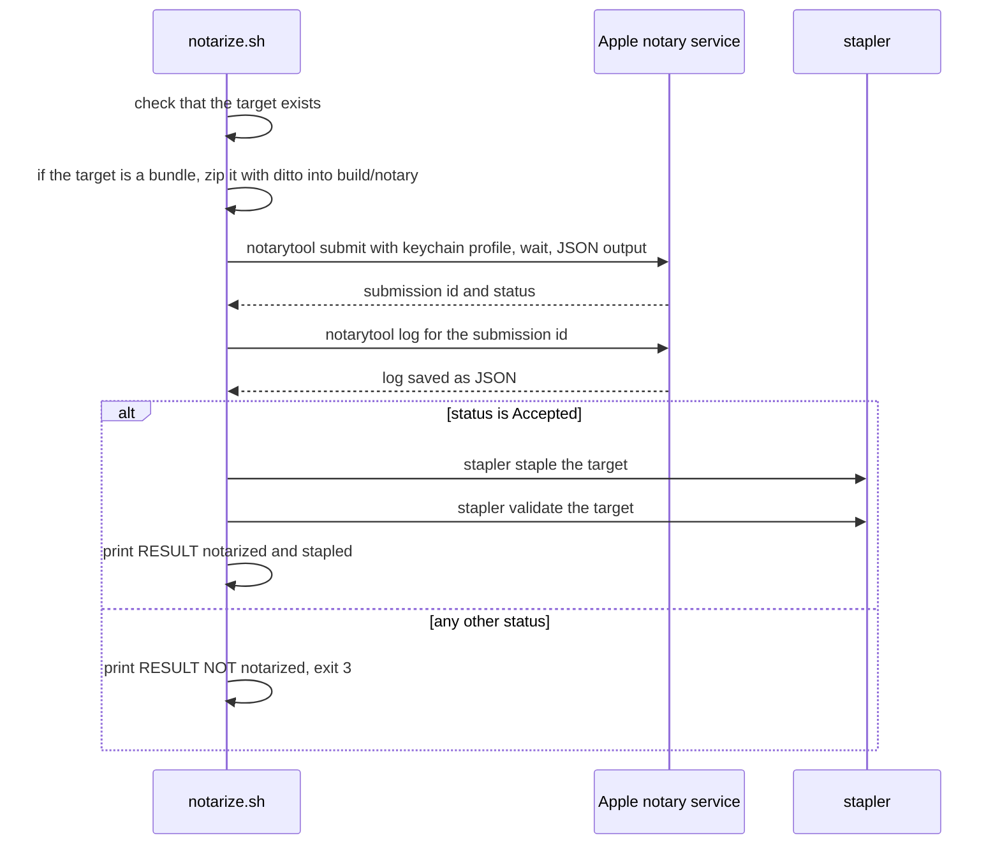

<!-- ORIX Clean / File: docs/release/notarization.md / Author: Simon-Pierre Boucher / Contact: contact@spboucher.ai -->
# Notarization

How `Scripts/notarize.sh` submits the application and the disk image to Apple's notary service, staples the
ticket and reports the result, and how to verify it independently.

This document describes a procedure. It does not state that any build has been notarized. The script itself
prints the word "notarized" only after Apple's service answered `Accepted`.

## Credentials

- The script uses an **existing** `notarytool` keychain profile. The profile name is taken from the environment
  variable `NOTARY_PROFILE` and defaults to `MacLustr-Notarize`.
- The profile is created once, outside this repository, with `xcrun notarytool store-credentials <name>`. It
  lives in the login keychain of the build machine.
- The script never creates, prints or changes credentials. **No credential is stored in the repository**: no
  Apple ID, app-specific password, API key or key file. `Scripts/check.sh` fails on `AuthKey_*`, `.p8` and
  similar files and on credential-like strings.

```sh
NOTARY_PROFILE=MyProfile Scripts/notarize.sh        # another profile
Scripts/notarize.sh                                  # default profile, default target
```

## Usage

```
Scripts/notarize.sh [target] [name]
```

| Argument | Default | Meaning |
|---|---|---|
| `target` | `dist/ORIX Clean.app` | What to notarize: the application bundle or the disk image |
| `name` | `app` | Label for the files written to `build/notary/` |

The release needs two submissions:

```sh
Scripts/notarize.sh                                        # the application
Scripts/package.sh                                         # builds the DMG and the ZIP from the stapled app
Scripts/notarize.sh dist/ORIXClean-<version>.dmg dmg       # the disk image
```

The application is notarized first because `package.sh` refuses to run until the application is stapled, so
that the copy inside the disk image and the ZIP already carries its ticket.

## What the script does



1. Stops with exit code 1 if the target does not exist.
2. A bundle cannot be uploaded as a directory: it is archived to `build/notary/<name>.zip` with
   `ditto -c -k --keepParent`. A disk image is submitted as is.
3. Runs `xcrun notarytool submit … --keychain-profile "$PROFILE" --wait --output-format json`. The JSON answer
   goes to `build/notary/<name>.json`, standard error to `build/notary/<name>.json.err`. If the command itself
   fails (network, credentials, malformed upload), the first lines of the error are shown and the script exits
   with code 2.
4. Reads `status` and `id` from the JSON and prints `submission <id>: <status>`.
5. Downloads the notary log to `build/notary/<name>-log.json` (best effort).
6. If the status is not exactly `Accepted`, prints `RESULT: NOT notarized` with the log path and exits with
   code 3.
7. Staples the ticket to the original target (the bundle, not the temporary zip) with `xcrun stapler staple`,
   then runs `xcrun stapler validate`.
8. Prints `RESULT: <target> is notarized by Apple (submission <id>) and stapled.`

| Exit code | Meaning |
|---|---|
| 0 | Accepted, stapled and validated |
| 1 | Target not found |
| 2 | `notarytool submit` failed before a verdict |
| 3 | A verdict other than `Accepted` |
| other | `stapler` failed (the script runs with `set -e`) |

## Files written

| File | Content |
|---|---|
| `build/notary/app.zip` | Upload archive of the application |
| `build/notary/app.json`, `dmg.json` | Answer of `notarytool submit`: `id`, `status`, `message` |
| `build/notary/app.json.err`, `dmg.json.err` | Standard error of the submission |
| `build/notary/app-log.json`, `dmg-log.json` | Notary log: issues found, per file |

`build/` is ignored by git. `Scripts/finalize.sh` later reads the submission ids from `app.json` and
`dmg.json`.

## Verifying independently

Do not rely on the script's last line alone; check the artifacts.

| Check | Command | Expected |
|---|---|---|
| Ticket is attached to the app | `xcrun stapler validate "dist/ORIX Clean.app"` | `The validate action worked!` |
| Ticket is attached to the image | `xcrun stapler validate dist/ORIXClean-<version>.dmg` | `The validate action worked!` |
| Gatekeeper accepts the app | `spctl --assess --type execute --verbose=2 "dist/ORIX Clean.app"` | `accepted`, `source=Notarized Developer ID` |
| Gatekeeper accepts the image | `spctl --assess --type open --context context:primary-signature --verbose=2 dist/ORIXClean-<version>.dmg` | `accepted`, `source=Notarized Developer ID` |
| Service-side record | `xcrun notarytool info <submission id> --keychain-profile "$NOTARY_PROFILE"` | `status: Accepted` |
| Service-side history | `xcrun notarytool history --keychain-profile "$NOTARY_PROFILE"` | The submission is listed |

The exact wording of `spctl` and `stapler` output can vary between macOS versions; the verdict (`accepted`,
validation succeeded) is what matters. The strongest end-to-end check is on a second Mac that has never seen
the build: download the image, open it, drag the application to Applications and launch it. Gatekeeper should
show the standard first-launch dialog for an application downloaded from the internet, with no warning about
an unidentified developer.

## When the verdict is not Accepted

Open `build/notary/<name>-log.json`. Typical findings and their source in this project:

| Finding in the log | Usual cause |
|---|---|
| The signature does not include a secure timestamp | `--timestamp` missing from `OTHER_CODE_SIGN_FLAGS` |
| The executable does not have the hardened runtime enabled | `ENABLE_HARDENED_RUNTIME` off |
| The executable requests the `get-task-allow` entitlement | A Debug build, or base entitlements injected |
| The binary is not signed with a valid Developer ID certificate | Ad hoc or development identity used |

`Scripts/sign.sh` checks the last three before any upload. Fix the cause, run `Scripts/sign.sh` again and
resubmit; a rejected submission cannot be amended.

## Notes

- Notarization requires network access from the build machine. The application itself contains no network
  code; this is a property of the release tooling only.
- Stapling lets Gatekeeper verify the ticket offline. An unstapled but notarized application still passes when
  the Mac is online, but the release process requires stapling.
- The ZIP artifact is not submitted separately: it is created from the already stapled application bundle.
