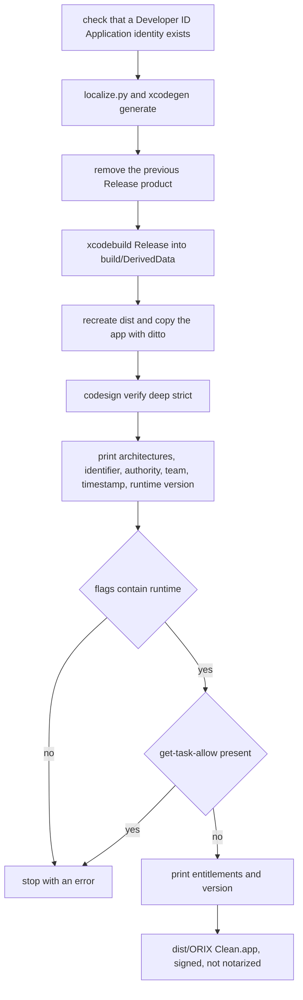

<!-- ORIX Clean / File: docs/release/signing.md / Author: Simon-Pierre Boucher / Contact: contact@spboucher.ai -->
# Signing

How the Release build is produced and signed by `Scripts/sign.sh`, and how to verify the result.

This document describes a procedure. It does not record the outcome of any run: whether a given build was
signed is established by the verification commands below, not by this file.

## What is signed, and how

| Setting (`project.yml`, Release) | Value |
|---|---|
| Identity | `Developer ID Application` (manual signing, `CODE_SIGN_STYLE: Manual`) |
| Team | `DEVELOPMENT_TEAM` from `project.yml` |
| Hardened Runtime | `ENABLE_HARDENED_RUNTIME: YES` |
| Secure timestamp | `OTHER_CODE_SIGN_FLAGS: --timestamp` |
| Entitlements | `App/ORIXClean.entitlements`, an empty dictionary; `CODE_SIGN_INJECT_BASE_ENTITLEMENTS: NO` so that Xcode adds none |
| Architectures | `arm64 x86_64`, `ONLY_ACTIVE_ARCH: NO` |
| Sandbox | off |

Debug builds are signed ad hoc and are not distributable.

The empty entitlements file is deliberate. The application needs no Hardened Runtime exception (no JIT, no
unsigned executable memory, no library-validation bypass, no Apple Events), and `get-task-allow` must be absent
for notarization. Access to protected folders is a matter of user consent (TCC), not of entitlements; see
`docs/research/macos-storage-capability-matrix.md`.

## Prerequisites

- A `Developer ID Application` certificate with its private key in a keychain on the build machine. The script
  only checks that one exists (`security find-identity -v -p codesigning`); it never creates, exports or prints
  key material.
- Xcode, XcodeGen and Python 3 (see `docs/development/setup.md`).

No certificate, key or profile is stored in the repository. `.gitignore` excludes `*.p8`, `*.p12`, `*.cer`,
`*.pem`, provisioning profiles, keychains, `AuthKey_*` and `.env*`, and `Scripts/check.sh` fails if such a file
is present.

## Procedure

```sh
Scripts/sign.sh
```



Steps performed by the script:

1. Stops if no Developer ID Application identity is in the keychain.
2. Regenerates the string catalogues and the Xcode project.
3. Deletes any previous Release product, then builds the `ORIXClean` scheme in Release.
4. Deletes `dist/`, recreates it and copies the built bundle to `dist/ORIX Clean.app` with `ditto`.
   Anything previously in `dist/` is removed at this point.
5. Verifies the copy: `codesign --verify --deep --strict --verbose=2`.
6. Prints the architectures (`lipo -archs`), the signing identifier, authority chain, team identifier,
   timestamp and runtime version, the code-signature flags, the entitlements as JSON and the bundle version.
7. Stops with an error if the flags do not include `runtime`, or if the entitlements contain
   `get-task-allow`.

The script uploads nothing. Its last line states that the application is built and signed and is **not**
notarized yet.

## Verifying a signed build

Run these on `dist/ORIX Clean.app`.

| Check | Command | Expected |
|---|---|---|
| Signature is valid and complete | `codesign --verify --deep --strict --verbose=2 "dist/ORIX Clean.app"` | `valid on disk` and `satisfies its Designated Requirement` |
| Who signed it | `codesign -dvv "dist/ORIX Clean.app"` | `Authority=Developer ID Application: …`, then the Developer ID and Apple Root authorities; a `TeamIdentifier`; a `Timestamp` line |
| Hardened Runtime | `codesign -dv "dist/ORIX Clean.app"` | `flags=` contains `runtime` |
| Entitlements | `codesign -d --entitlements - --xml "dist/ORIX Clean.app"` | An empty dictionary; in particular no `get-task-allow` |
| Architectures | `lipo -archs "dist/ORIX Clean.app/Contents/MacOS/ORIX Clean"` | Both `arm64` and `x86_64` |
| Bundle identifier and version | `/usr/libexec/PlistBuddy -c 'Print CFBundleIdentifier' "dist/ORIX Clean.app/Contents/Info.plist"` | `ai.spboucher.orix.clean`; likewise `CFBundleShortVersionString`, `CFBundleVersion`, `LSMinimumSystemVersion` |

A signed but not yet notarized application is expected to be rejected by Gatekeeper at this stage:
`spctl --assess --type execute` reports that it is not notarized. That is the next step, in
`notarization.md`.

## Failure cases

| Symptom | Cause | Action |
|---|---|---|
| `ERROR: no Developer ID Application identity in the keychain.` | Certificate or private key missing, or keychain locked | Install the certificate with its key; unlock the keychain |
| `ERROR: Release build failed.` | Compilation or signing error; only `error:` lines and the build verdict are printed | Run the `xcodebuild` command from the script without the filter to see the full log |
| `ERROR: Hardened Runtime is not enabled.` | Build setting changed | Restore `ENABLE_HARDENED_RUNTIME: YES` |
| `ERROR: get-task-allow present.` | Base entitlements were injected | Restore `CODE_SIGN_INJECT_BASE_ENTITLEMENTS: NO` and the empty entitlements file |
| `codesign --verify` fails after copying | Bundle modified after signing | Never edit `dist/ORIX Clean.app`; rebuild |

## Notes

- The script signs through `xcodebuild`; it does not call `codesign --sign` on the application itself. The
  disk image is signed later by `Scripts/package.sh`, with the identity read from the application's signature.
- The application embeds no third-party framework, helper tool or XPC service; `--deep` in the verification is
  a completeness check.
- The `x86_64` slice is built and signed but has not been run on an Intel Mac.
